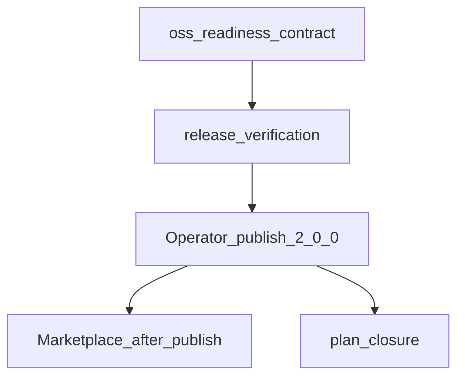

# Savepoints Lite public OSS readiness (@2.0.0)

## Recommended execution authority

| Slice | Recommended authority | Agent instruction |
| --- | --- | --- |
| plan-review | Plan-only PR | Completed via [PR #13](https://github.com/multipliers-dev/savepoints-lite/pull/13). |
| plan-revision-explicit-integration | Plan-only PR | Revise plan only; do not implement slices. Stop after opening the plan-only PR. |
| oss-readiness-contract | Open PR only | savepoints-lite hub only. Do not edit cursor-team-marketplace. Do not merge or publish npm. |
| release-verification | Open PR only | savepoints-lite hub only. May combine with oss-readiness-contract in one merge-safe PR. Do not merge or publish npm. |
| plan-closure | Open PR only | Docs-only archive PR after operator publish evidence. Do not merge. |

Repo default: **Open PR only** (plan-only slices for plan artifacts only).

## Repository topology

Multi-slice plans stack execution order, not Git branches. Integration branch is `main` for **multipliers-dev/savepoints-lite** only.

**Before implementation:** `git fetch` and branch from latest `origin/main` in savepoints-lite.

**Before opening the PR:** branch contains only the current slice.

**After opening the PR:** GitHub base is `main`; diff excludes prior-slice work except through merged `main`.

**Cross-repo:** This plan does **not** authorize edits in consumer repositories or in `cursor-team-marketplace`. Personal distribution and consumer cleanup are tracked in [`cursor-team-marketplace` Savepoints marketplace distribution plan](https://github.com/multipliers-dev/cursor-team-marketplace/blob/main/.cursor/plans/2026-10-27-savepoints-marketplace-distribution.plan.md) (PR #70) — reference only; do not modify that plan from savepoints-lite PRs.

---

## Background

**End state:** Published **`@multipliers-dev/savepoints-lite@2.0.0`** is a verified, publicly usable instruction-only npm package with accurate docs, no maintainer Notion destination in the tarball, and a three-tier **`destination.data_source_id`** resolution contract (explicit integration → optional consumer `.agents` → optional packaged defaults).

**Published today:** `@multipliers-dev/savepoints-lite@1.1.0` — package [`skills/savepoints-notion/defaults.yml`](skills/savepoints-notion/defaults.yml) still includes maintainer `data_source_id` `822cbc89-7c89-4863-af3a-2fe0cd8ab56e` (not a credential). No `.env` support.

**Supersession (PR #13 consumer migration withdrawn):** The original plan required seven consumer repositories to commit `.agents/savepoints-notion.yml` before hub work. That approach is **no longer** the intended personal distribution path. Team-harness + marketplace (separate repository plan) will vend skills and supply the explicit-integration tier after **`@2.0.0` exists on npm**. This plan does **not** include consumer-repository migration, cleanup, or pin-bump PRs.

**Standalone npm consumers:** Repositories installing the package directly may still use optional [`.agents/savepoints-notion.yml`](.agents/savepoints-notion.yml) (tier 2). Document in [`docs/adopt.md`](docs/adopt.md) and [`docs/architecture.md`](docs/architecture.md); do not require it for marketplace-backed installs.

### Handoff boundary


| Responsibility | Owner | Notes |
| --- | --- | --- |
| Configuration contract + OSS docs/tests | savepoints-lite (`oss-readiness-contract`, `release-verification`) | Delivers merge-ready `2.0.0` source; agent does not `npm publish` |
| Registry publish | Operator (`gate-publish` in marketplace plan) | [`docs/publishing.md`](docs/publishing.md) workflow |
| Marketplace vendoring, wrapper skill, User Rules, consumer cleanup | cursor-team-marketplace | **After** publish only |

**Final deliverable from this repository:** operator-published, verified `@multipliers-dev/savepoints-lite@2.0.0` on the public npm registry.

**Out of scope here:** marketplace `vendor/` sync, team-harness wrapper skills, engineering invariants / User Rules, removing per-repo npm deps or `AGENTS.md` activation.

**Coordination:** Cursor Team Marketplace treats the published Savepoints Lite `2.0.0` release as an external prerequisite. All OSS readiness and configuration-contract implementation is owned by this repository.

### Execution flow



`release-verification` may land in the **same** hub PR as `oss-readiness-contract`. `plan-closure` runs **after** operator publish evidence is recorded (registry version + install check per [`docs/publishing.md`](docs/publishing.md)).

---

## Configuration contract (`@2.0.0`)

Instruction-only; no environment variables, hooks, background processes, or new runtime dependencies.

### `destination.data_source_id` precedence

| Tier | Source | When it applies |
| --- | --- | --- |
| 1 (highest) | Explicit destination from the **calling integration**, carried in **instruction/delegation context** (router → Notion provider handoff) | Integration supplied a destination for this Savepoint delegation |
| 2 | Consumer [`.agents/savepoints-notion.yml`](.agents/savepoints-notion.yml) | Tier 1 **absent** for this delegation |
| 3 | Packaged [`skills/savepoints-notion/defaults.yml`](skills/savepoints-notion/defaults.yml) | Tier 1 absent and tier 2 absent or unset; only if defaults configure a non-empty id |

**Preserve existing behavior for tiers 2–3:** consumer `.agents` **overrides** packaged defaults (unchanged relative to v1.1.0, aside from removing the maintainer UUID from the package).

### Resolution and failure semantics

- **Router** ([`skills/savepoints/SKILL.md`](skills/savepoints/SKILL.md)): on delegation to the Notion provider, **carry** any explicit `destination.data_source_id` from the integration in instruction context. Router does not call Notion MCP or read host User Rules.
- **Provider** ([`skills/savepoints-notion/SKILL.md`](skills/savepoints-notion/SKILL.md)): resolve tiers 1 → 2 → 3; **must not** depend on discovering Cursor User Rules or other host-specific rule stores.
- **Missing resolved destination** (empty after applicable tiers): **fail open** — no Notion MCP write; continue primary work; preserve `success` / `failure` / `unconfirmed` outcome semantics.
- **Tier 1 present but invalid** (empty, malformed UUID, or otherwise unusable): **fail open without fallback** to tier 2 or tier 3 — do not silently use `.agents` or packaged defaults.
- **External integrations:** document provider-neutral handoff (e.g. wrapper skill states `destination.data_source_id` in delegation prose before invoking the router). Public package stays host-agnostic — no Cursor-specific APIs.

### Package hygiene

- Remove maintainer `822cbc89-7c89-4863-af3a-2fe0cd8ab56e` from shipped [`skills/savepoints-notion/defaults.yml`](skills/savepoints-notion/defaults.yml), generic examples in provider SKILL, and tarball grep policy.
- Add [`templates/consumer/savepoints-notion.yml.example`](templates/consumer/savepoints-notion.yml.example) with `YOUR_NOTION_DATA_SOURCE_ID`.
- Router/provider separation unchanged; provider owns Notion mapping and MCP write + bounded confirmation.

### Implementation decisions (non-blocking)

Resolve during `oss-readiness-contract` / `release-verification`; none block merging this plan or starting hub implementation.

1. **Instruction-context field name** for tier 1 (e.g. `integration.destination.data_source_id` vs a labeled delegation block) — pick one; enforce via skill markdown + tests.
2. **Packaged `defaults.yml` shape** when tier 3 is optional: empty string vs omitted key vs placeholder only in the example template (must not ship maintainer UUID).
3. **Plan closure timing:** archive after publish evidence on registry (recommended) — record version, date, and clean install check in closure PR or `# Shipped` note.

---

## Hub package version vs registry dogfood pin

The hub [`package.json`](package.json) carries two version concepts during the pre-publish implementation PR:

| Field | Role during implementation PR (pre-publish) | After operator publishes `@2.0.0` |
| --- | --- | --- |
| `"version"` | **`2.0.0`** (release candidate in git) | **`2.0.0`** on registry |
| `devDependencies["@multipliers-dev/savepoints-lite"]` | Stays **`1.1.0`** (exact pin + lockfile) | Bumped to **`2.0.0`** in a **follow-up** hub PR |

**Why:** `npm ci` installs the self-devDependency from the **public registry**, not the workspace tree. [`AGENTS.md`](AGENTS.md) session logging reads skills from `node_modules/@multipliers-dev/savepoints-lite/` (published artifact), not git `skills/` until the dogfood pin catches up.

**Verification (must not be weakened):**

| Gate | What it validates | Pre-publish expectation |
| --- | --- | --- |
| `npm run verify` | Workspace source + [`scripts/expected-package-paths.txt`](scripts/expected-package-paths.txt) via `npm pack --dry-run` | **2.0.0** release candidate tarball |
| `npm test` (package invariants) | Workspace rules + **registry dogfood** under `node_modules/` | Installed package **version** matches devDependency pin (`1.1.0`) |
| `installed registry dogfood artifact matches expected publish layout` ([`test/package-invariants.test.js`](test/package-invariants.test.js)) | Lists files in `node_modules/@multipliers-dev/savepoints-lite` vs workspace allowlist | **May diverge** until post-publish dogfood bump |

**Implementation requirement:** Split or extend verification so both remain true without bypass:

1. **Source / release-candidate pack** — `npm run verify` asserts workspace **2.0.0** layout.
2. **Registry dogfood** — tests assert installed **`@1.1.0`** independently until follow-up PR bumps pin.
3. **`npm ci` stays reproducible** — do not bump devDependency to `2.0.0` before the version exists on npm; no `file:` dogfood link in the pre-publish PR.
4. **No gate weakening** — do not delete dogfood layout checks or skip `npm test` / `npm run verify`.

**Post-publish:** operator publishes `@2.0.0` → follow-up hub PR bumps devDependency and lockfile → `npm ci` → dogfood checks align with workspace allowlist again.

---

## Slice — plan-revision-explicit-integration

**Recommended authority:** Plan-only PR

**Rationale:** Architecture shift (marketplace distribution) requires an updated authoritative plan before hub implementation.

**Agent instruction:** Commit revised plan only; do not implement `oss-readiness-contract` or later slices.

**Acceptance:**

- [`.cursor/plans/2026-10-27-oss-readiness-cleanup.plan.md`](2026-10-27-oss-readiness-cleanup.plan.md) reflects explicit-integration contract and marketplace handoff
- `npm run validate:plans` passes
- `plan-revision-explicit-integration` marked `completed` in frontmatter

---

## Slice — oss-readiness-contract

**Recommended authority:** Open PR only

**Rationale:** Breaking configuration change (explicit tier + removal of packaged maintainer destination) → semver **`2.0.0`**, plus public OSS documentation accuracy.

**Agent instruction:** savepoints-lite hub only; may combine with `release-verification` in one merge-safe PR; do not merge, publish npm, or edit cursor-team-marketplace.

**Goal:** Implement configuration contract (above), package cleanup, tests, and documentation.

**Acceptance:**

- **Skills / config:** three-tier `destination.data_source_id` precedence; router carries explicit destination in delegation context; provider does not read User Rules; tier-1-invalid no fallback; missing destination fail-open without MCP write
- [`skills/savepoints-notion/defaults.yml`](skills/savepoints-notion/defaults.yml): no maintainer `data_source_id`; decide tier-3 defaults shape during implementation (see non-blocking decisions above)
- [`templates/consumer/savepoints-notion.yml.example`](templates/consumer/savepoints-notion.yml.example) with `YOUR_NOTION_DATA_SOURCE_ID`
- [`scripts/expected-package-paths.txt`](scripts/expected-package-paths.txt) updated if new template paths ship
- Tests updated (including no maintainer UUID in shipped paths; precedence / fail-open invariants as practical)
- **Documentation:** README, [`AGENTS.md`](AGENTS.md), [`docs/adopt.md`](docs/adopt.md), [`docs/architecture.md`](docs/architecture.md), [`docs/publishing.md`](docs/publishing.md), [`skills/README.md`](skills/README.md) — `@2.0.0` messaging, installation, explicit-integration precedence, provider-neutral external integration example
- **Privacy:** what session Savepoints write to Notion; host-owned Notion MCP auth; no credentials or personal destination IDs in the package
- **Reliability:** best-effort fail-open, no retry queue, instruction-only, bounded async confirmation
- **Maintenance / support:** public npm and GitHub; no implied SLA; preserve [`docs/adoption-verification-record.md`](docs/adoption-verification-record.md) history (not in tarball)
- **Scope guard:** no new `CONTRIBUTING.md`, `SECURITY.md`, or issue-template governance infra
- `"version": "2.0.0"` in hub `package.json`; devDependency self-pin remains **`1.1.0`** until post-publish follow-up
- Ready PR opened (Open PR only)

---

## Slice — release-verification

**Recommended authority:** Open PR only

**Rationale:** Prove release candidate layout and gates before operator publish; document publish procedure.

**Agent instruction:** savepoints-lite hub only; may be same PR as `oss-readiness-contract`; do not `npm publish`.

**Goal:** Full hub verification and operator publish checklist alignment.

**Acceptance:**

- `npm ci` reproducible (registry install of `@1.1.0` devDependency succeeds)
- `npm test` passes including **split** workspace 2.0.0 pack vs registry `@1.1.0` dogfood checks (no weakening)
- `npm run verify` passes for workspace **2.0.0** candidate vs `expected-package-paths.txt`
- `npm run validate:plans` passes
- Tarball candidate: no personal destination in package defaults (grep / invariant tests)
- [`docs/publishing.md`](docs/publishing.md) (or release PR body) reflects operator preflight: `npm view @multipliers-dev/savepoints-lite@2.0.0 version` must 404 before publish; post-publish install check documented
- Post-publish hub dogfood bump to `2.0.0` documented as follow-up PR (not executed in agent slice)
- Mark `release-verification` completed when merged with passing gates

---

## Slice — plan-closure

**Recommended authority:** Open PR only

**Rationale:** Archive completed plan per repository convention after shipped release.

**Agent instruction:** Docs-only; move plan to [`.cursor/plans/archive/`](archive/). **Prerequisite:** operator publish evidence for `@2.0.0` on npm.

**Acceptance:**

- `# Shipped` note with PR links, publish date, registry version evidence
- Plan moved to `.cursor/plans/archive/2026-10-27-oss-readiness-cleanup.plan.md`
- `plan-closure` todo completed; agent prompt references updated to archived path
- `npm run validate:plans` passes

---

## Agent prompts (copy/paste for Cursor)

### oss-readiness-contract

```text
@.cursor/plans/2026-10-27-oss-readiness-cleanup.plan.md

Implement slice oss-readiness-contract only on multipliers-dev/savepoints-lite.

Authority: Open PR only — do not merge, npm publish, or edit cursor-team-marketplace.

Topology: git fetch; branch from latest origin/main; PR base main; hub repo only — no consumer-repository PRs.

Deliverables: @2.0.0 explicit-integration destination.data_source_id contract (tier 1 integration context → tier 2 .agents/savepoints-notion.yml → tier 3 packaged defaults); router carries explicit destination in delegation context; provider must not read User Rules; tier-1-invalid fail open without fallback to tiers 2–3; remove maintainer UUID from shipped defaults and skill examples; templates/consumer/savepoints-notion.yml.example; tests and expected-package-paths.txt if needed; README, AGENTS.md, docs/, skills/ README for privacy, reliability, maintenance, and provider-neutral external integration handoff (docs/architecture.md, docs/adopt.md). Hub package.json version 2.0.0; devDependencies self-pin stays 1.1.0 until post-publish follow-up.

Do not: marketplace vendoring, wrapper skills, User Rules, consumer cleanup, or per-repo migration PRs.

Verification: npm test && npm run verify && npm run validate:plans. Mark oss-readiness-contract completed in frontmatter in the same PR (combine with release-verification in one PR if merge-safe).
```

### release-verification

```text
@.cursor/plans/2026-10-27-oss-readiness-cleanup.plan.md

Implement slice release-verification only on multipliers-dev/savepoints-lite.

Authority: Open PR only — do not merge or npm publish.

Topology: origin/main; PR base main. May combine with oss-readiness-contract in one merge-safe PR if not already done.

Deliverables: npm ci reproducible; split workspace 2.0.0 pack verification vs registry @1.1.0 dogfood tests (no gate weakening); operator publish checklist aligned with docs/publishing.md; document post-publish hub dogfood bump follow-up PR.

Do not: npm publish, consumer-repo work, or cursor-team-marketplace edits.

Verification: npm ci && npm test && npm run verify && npm run validate:plans. Mark release-verification completed in frontmatter in the same PR.
```

### plan-closure

```text
@.cursor/plans/2026-10-27-oss-readiness-cleanup.plan.md

Implement slice plan-closure only.

Authority: Open PR only — docs-only archive PR; do not merge.

Prerequisites: oss-readiness-contract and release-verification merged; operator published @multipliers-dev/savepoints-lite@2.0.0 to npm (registry evidence recorded).

Topology: savepoints-lite hub; branch from origin/main; PR base main.

Deliverables: # Shipped note with PR links and publish evidence; move plan to .cursor/plans/archive/2026-10-27-oss-readiness-cleanup.plan.md; mark plan-closure completed; update references to archived path.

Verification: npm run validate:plans.
```
