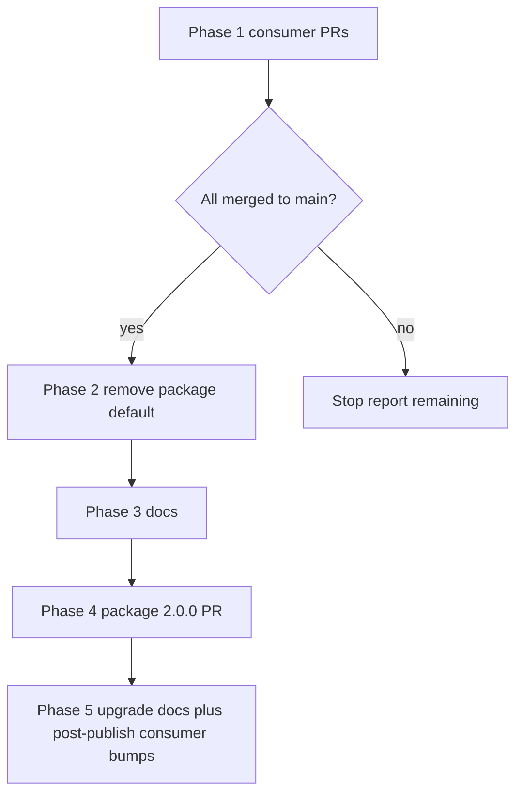

# Savepoints Lite public-repository cleanup (phased)

## Recommended execution authority

| Slice | Recommended authority | Agent instruction |
| --- | --- | --- |
| plan-review | Plan-only PR | Do not implement slices. Stop after opening the plan-only PR. |
| phase1-inventory | Open PR only | Report inventory; optional plan table update in a PR if operator requests. Do not merge. |
| phase1-consumer-prs | Open PR only | One consumer repo per PR. Do not merge. |
| phase1-checkpoint | Manual verification gate | Verify main branches only; no implementation PR. Stop with pass/fail report. |
| phase2-package-config | Open PR only | savepoints-lite hub only. **Prerequisite:** phase1-checkpoint passed. Do not merge or publish. |
| phase3-docs | Open PR only | savepoints-lite hub only. **Prerequisite:** phase1-checkpoint passed. May combine with phase2/phase4 in one merge-safe PR. Do not merge. |
| phase4-release-prep | Open PR only | savepoints-lite hub only. **Prerequisite:** phase1-checkpoint passed. Do not merge or publish npm. |
| phase5-upgrade-prep | Open PR only | **Docs:** upgrade procedure in hub adopt/docs (may merge with phase4 PR). **Execution:** consumer `@2.0.0` bump PRs only after operator publishes registry release — not part of this slice’s hub PR. |
| plan-closure | Open PR only | Docs-only archive PR. Do not merge. |

Repo default: **Open PR only** (plan-review for plan artifact only).

## Repository topology

Multi-slice plans stack execution order, not Git branches. Integration branch is `main` for every repository.

**Before implementation:** `git fetch` and branch from latest `origin/main` in the target repo.

**Before opening the PR:** branch contains only the current slice.

**After opening the PR:** GitHub base is `main`; diff excludes prior-slice work except through merged `main`.

**Cross-repo:** Phase 1 opens PRs in each consumer repository. Phases 2–4 target `multipliers-dev/savepoints-lite` (one merge-safe hub implementation PR is typical).

**Phase 5 sequencing:** Distinguish **documenting** the post-`2.0.0` upgrade procedure from **executing** consumer upgrades. Upgrade **documentation** may ship in the same hub PR as phase4 (before npm publish). **Consumer version-bump PRs** wait until `@2.0.0` exists on the registry (operator publish after phase4 merge) — those are separate per-repo PRs, not phase5 hub deliverables.

---

## Background

**End state:** Every confirmed consumer commits `.agents/savepoints-notion.yml` with `destination.data_source_id`. Published **`@2.0.0`** ships no personal Notion destination in [`skills/savepoints-notion/defaults.yml`](skills/savepoints-notion/defaults.yml).

**Published today:** `@multipliers-dev/savepoints-lite@1.1.0` — package [`skills/savepoints-notion/defaults.yml`](skills/savepoints-notion/defaults.yml) includes maintainer `data_source_id` `822cbc89-7c89-4863-af3a-2fe0cd8ab56e` (not a credential; OK in consumer repos). No `.env` support.

**Workspace inventory (re-verify in phase1-inventory):**

| Repository | Pin | Savepoints `AGENTS.md` | `.agents/savepoints-notion.yml` |
| --- | --- | --- | --- |
| `multipliers-dev/savepoints-lite` | 1.1.0 | Yes | None |
| `multipliers-dev/cursor-team-marketplace` | 1.1.0 | Yes | None |
| `multipliers-dev/editorial-workflow` | 1.1.0 | Yes | None |
| `multipliers-dev/renovate-workflow` | 1.1.0 | Yes | None |
| `mastermichaelt/resumes` | 1.1.0 | Yes | None |
| `mastermichaelt/portfolio` | 1.1.0 | Yes | None |
| `multipliers-dev/codenames-ai-guesser` | 1.1.0 | Yes | None |

Not a consumer: `multipliers-dev/savepoints` (no `savepoints-lite` dependency).



**Hard checkpoint:** Do not start **any** hub implementation slice (`phase2-package-config`, `phase3-docs`, `phase4-release-prep`) until `phase1-checkpoint` passes — every confirmed consumer has `.agents/savepoints-notion.yml` merged to `main`. Standalone agent prompts for phases 2–4 must restate this gate.

### Hub package version vs registry dogfood pin

The hub [`package.json`](package.json) carries two version concepts:

| Field | Role during phase 4 PR (pre-publish) | After operator publishes `@2.0.0` |
| --- | --- | --- |
| `"version"` | May become **`2.0.0`** (release candidate in git) | **`2.0.0`** on registry |
| `devDependencies["@multipliers-dev/savepoints-lite"]` | Stays **`1.1.0`** (exact pin + lockfile) | Bumped to **`2.0.0`** in a **follow-up** hub PR |

**Why:** `npm ci` installs the self-devDependency from the **public registry**, not the workspace tree. [`AGENTS.md`](AGENTS.md) session logging reads skills from `node_modules/@multipliers-dev/savepoints-lite/` (published artifact), not git `skills/` until dogfood pin catches up.

**Verification today (must not be weakened):**

| Gate | What it validates | Pre-publish expectation |
| --- | --- | --- |
| `npm run verify` | Workspace source + [`scripts/expected-package-paths.txt`](scripts/expected-package-paths.txt) via `npm pack --dry-run` | **2.0.0 release candidate** tarball (including new paths such as example templates) |
| `npm test` (package invariants) | Workspace rules + **registry dogfood** install under `node_modules/` | Installed package **version** matches devDependency pin (`1.1.0`); see below |
| `installed registry dogfood artifact matches expected publish layout` ([`test/package-invariants.test.js`](test/package-invariants.test.js)) | Lists files in `node_modules/@multipliers-dev/savepoints-lite` vs workspace `expected-package-paths.txt`; compares `installedPkg.files` to workspace `files` | **Will diverge** once workspace `expected-package-paths.txt` grows for 2.0.0 while registry dogfood remains `@1.1.0` |

**Implementation requirement:** Before claiming phase 4 verification passes, the hub implementation PR must **split or extend** verification so both remain true without bypass:

1. **Source / release-candidate pack** — `npm run verify` (and any pack-focused tests) assert the **workspace** `2.0.0` candidate layout.
2. **Registry dogfood** — tests assert the **installed `@1.1.0`** artifact independently (e.g. separate allowlist or conditional expectations keyed on devDependency pin vs workspace `version`) until the follow-up PR bumps the pin to `2.0.0` after publish.
3. **`npm ci` stays reproducible** — do not bump devDependency to `2.0.0` before the version exists on npm; do not use `file:` link for dogfood in the pre-publish PR.
4. **No gate weakening** — do not delete dogfood layout checks or stop running `npm test` / `npm run verify` to mask the version skew.

If scripts/tests cannot express the split yet, **update them in the same implementation PR** as the phase 2–4 code changes (not in this plan-only PR).

**Post-publish (operator + follow-up hub PR):** publish `@2.0.0` → bump hub devDependency and lockfile to `2.0.0` → `npm ci` → dogfood layout checks align with workspace allowlist again.

---

## Slice — plan-review

**Recommended authority:** Plan-only PR

**Rationale:** Staged multi-repo migration requires reviewed plan before consumer and package work.

**Agent instruction:** Commit plan only; do not implement other slices.

**Acceptance:**

- [`.cursor/plans/2026-10-27-oss-readiness-cleanup.plan.md`](2026-10-27-oss-readiness-cleanup.plan.md) on `main` via plan-only PR
- `npm run validate:plans` passes

---

## Slice — phase1-inventory

**Recommended authority:** Open PR only

**Rationale:** Consumer list may drift; confirm before opening seven configuration PRs.

**Agent instruction:** Re-scan dependencies; report adoption gaps. Do not merge.

**Acceptance:**

- Confirmed consumer list documented (chat or plan table update if operator requests a PR)
- No Phase 2 work started

---

## Slice — phase1-consumer-prs

**Recommended authority:** Open PR only

**Rationale:** Explicit destination in each repo preserves logging before package default removal.

**Agent instruction:** One PR per consumer repo; pin stays `1.1.0`; do not merge.

**Acceptance:**

- Per consumer PR: `.agents/savepoints-notion.yml` with `destination.data_source_id: "822cbc89-7c89-4863-af3a-2fe0cd8ab56e"`
- Other `.agents/` files preserved
- Repo validation commands pass
- Ready PR opened

| Repo | Typical validation |
| --- | --- |
| savepoints-lite | `npm test`, `npm run verify` |
| cursor-team-marketplace | `npm test`, `npm run validate:plans` |
| editorial-workflow | `npm test`, `npm run typecheck` |
| renovate-workflow | `npm test`, `npm run typecheck` |
| resumes | `npm run typecheck`, `npm test` |
| portfolio | `npm run lint`, `npm run typecheck`, `npm test` |
| codenames-ai-guesser | `npm test`, `npm run typecheck` |

---

## Slice — phase1-checkpoint

**Recommended authority:** Manual verification gate

**Rationale:** Package breaking change must not ship while consumers still rely on packaged default only.

**Agent instruction:** Verify merges on `main`; stop with report if any consumer missing config.

**Acceptance:**

- Every confirmed consumer: `main` contains `.agents/savepoints-notion.yml`
- Explicit go/no-go recorded before phase2

---

## Slice — phase2-package-config

**Recommended authority:** Open PR only

**Prerequisite:** phase1-checkpoint passed.

**Rationale:** Remove maintainer destination from npm tarball; mandatory consumer file for writes.

**Agent instruction:** Hub repo only; may combine with phase3/phase4 in one PR; do not merge or publish.

**Acceptance:**

- [`skills/savepoints-notion/defaults.yml`](skills/savepoints-notion/defaults.yml) has no real `data_source_id`
- [`skills/savepoints-notion/SKILL.md`](skills/savepoints-notion/SKILL.md) resolves destination only from `.agents/savepoints-notion.yml`; missing → fail open, no MCP write
- [`templates/consumer/savepoints-notion.yml.example`](templates/consumer/savepoints-notion.yml.example) uses `YOUR_NOTION_DATA_SOURCE_ID`
- Tests updated; [`scripts/expected-package-paths.txt`](scripts/expected-package-paths.txt) if template added
- No maintainer UUID in shipped package paths (grep policy in slice body of archived plan reference)

---

## Slice — phase3-docs

**Recommended authority:** Open PR only

**Prerequisite:** phase1-checkpoint passed (same hard gate as phase2; do not open a standalone phase3 hub PR before every consumer has explicit Notion destination on `main`).

**Rationale:** Public repo accuracy for privacy, reliability, maintenance, and `@1.1.0` / `@2.0.0` messaging.

**Agent instruction:** Update README, AGENTS.md, docs/, skills/ per plan; preserve [`docs/adoption-verification-record.md`](docs/adoption-verification-record.md) historical rows. If combined with phase2/phase4, still require checkpoint before starting the combined PR.

**Acceptance:**

- Version accuracy, privacy, reliability, maintenance sections per plan
- No `CONTRIBUTING.md`, `SECURITY.md`, issue templates, or governance infra

---

## Slice — phase4-release-prep

**Recommended authority:** Open PR only

**Prerequisite:** phase1-checkpoint passed — confirm every consumer has `.agents/savepoints-notion.yml` on `main` before bumping hub `"version"` or removing packaged defaults.

**Rationale:** Breaking configuration change → semver `2.0.0`.

**Agent instruction:**

- Set hub **`"version": "2.0.0"`**; keep **`devDependencies["@multipliers-dev/savepoints-lite"]: "1.1.0"`** until after operator publishes `@2.0.0` (follow-up hub PR bumps dogfood pin).
- Run full hub gates per **Hub package version vs registry dogfood pin** (split source pack vs registry dogfood verification if needed).
- Do not `npm publish`.

**Acceptance:**

- `"version": "2.0.0"` in hub `package.json`; devDependency self-pin remains **`1.1.0`** until post-publish follow-up
- `npm ci` reproducible (registry install of `@1.1.0` succeeds)
- `npm run verify` passes for **workspace 2.0.0 release candidate** (pack dry-run vs `expected-package-paths.txt`)
- `npm test` passes including **independent** registry dogfood checks (update tests/scripts if layout skew requires split allowlists — no weakening)
- `npm run validate:plans` passes
- Tarball candidate: no personal destination in package defaults
- Optional in the same PR: phase5 **documentation** (post-`2.0.0` upgrade procedure) — docs may be written pre-publish; **consumer pin-bump PRs** still wait for registry `@2.0.0`

---

## Slice — phase5-upgrade-prep

**Recommended authority:** Open PR only

**Rationale:** Operators and consumers need a written upgrade path; executing bumps is a separate step after publish.

**Agent instruction:**

- **Documentation (hub):** Add post-`2.0.0` consumer upgrade steps to [`docs/adopt.md`](docs/adopt.md) (or equivalent). May land in the **same merge-safe PR as phase4**; mark `phase5-upgrade-prep` completed when that documentation merges.
- **Execution (consumers):** Open consumer pin-bump PRs to `@2.0.0` **only after** phase4 is merged **and** the operator has published `@2.0.0` to npm. Not required to complete the hub phase5 slice.

**Prerequisite for consumer bump PRs only:** `@2.0.0` on the public registry (operator action after phase4 merge). **Not** a prerequisite for writing upgrade documentation in the hub.

**Acceptance:**

- [`docs/adopt.md`](docs/adopt.md) (or equivalent) describes post-`2.0.0` consumer steps (including that Phase 1 destination files can stay unchanged when staying on the maintainer database)
- No consumer `@2.0.0` bump PRs opened against an unpublished package version

---

## Slice — plan-closure

**Recommended authority:** Open PR only

**Rationale:** Archive completed plan per repository convention.

**Agent instruction:** Docs-only; move plan to `.cursor/plans/archive/`.

**Acceptance:**

- `# Shipped` note; plan archived; `plan-closure` todo completed

---

## Agent prompts (copy/paste for Cursor)

### plan-review

```text
@.cursor/plans/2026-10-27-oss-readiness-cleanup.plan.md

Implement slice plan-review only.

Authority: Plan-only PR — do not implement other slices. Stop after opening the PR.

Topology: branch from latest origin/main in multipliers-dev/savepoints-lite; PR base main.

Deliverables: commit .cursor/plans/2026-10-27-oss-readiness-cleanup.plan.md only.

Verification: npm run validate:plans. Mark plan-review completed in frontmatter in the same PR.
```

### phase1-inventory

```text
@.cursor/plans/2026-10-27-oss-readiness-cleanup.plan.md

Implement slice phase1-inventory only.

Authority: Open PR only — do not merge.

Topology: N/A (read-only scan); if committing table updates, branch from origin/main in savepoints-lite.

Deliverables: confirmed consumer inventory report; optional plan table PR.

Verification: grep package.json across workspaces for @multipliers-dev/savepoints-lite. Do not start phase1-consumer-prs in the same run unless asked.
```

### phase1-consumer-prs

```text
@.cursor/plans/2026-10-27-oss-readiness-cleanup.plan.md

Implement slice phase1-consumer-prs for <owner/repo> only.

Authority: Open PR only — do not merge.

Topology: branch from origin/main in <owner/repo>; PR base main; only this repo's config file.

Deliverables: .agents/savepoints-notion.yml with destination.data_source_id "822cbc89-7c89-4863-af3a-2fe0cd8ab56e"; pin stays 1.1.0.

Verification: run this repo's standard test/lint/typecheck gates from the plan slice table. Open ready PR; report URL.
```

### phase1-checkpoint

```text
@.cursor/plans/2026-10-27-oss-readiness-cleanup.plan.md

Implement slice phase1-checkpoint only.

Authority: Manual verification gate — no implementation PR.

Topology: verify origin/main on each confirmed consumer.

Deliverables: pass/fail report listing repos missing merged .agents/savepoints-notion.yml.

Verification: gh / git show origin/main:.agents/savepoints-notion.yml per repo. Stop before phase2 if any fail.
```

### phase2-package-config

```text
@.cursor/plans/2026-10-27-oss-readiness-cleanup.plan.md

Implement slice phase2-package-config only on multipliers-dev/savepoints-lite.

Authority: Open PR only — do not merge or publish.

Prerequisite: phase1-checkpoint passed — every confirmed consumer has .agents/savepoints-notion.yml merged to main. If not passed, stop; do not remove packaged defaults or change provider destination resolution.

Topology: origin/main; PR base main.

Deliverables: remove packaged Notion destination; mandatory .agents/savepoints-notion.yml in provider skill; example template; tests.

Verification: npm test && npm run verify. Mark phase2-package-config completed in frontmatter in the same PR.
```

### phase3-docs

```text
@.cursor/plans/2026-10-27-oss-readiness-cleanup.plan.md

Implement slice phase3-docs only on multipliers-dev/savepoints-lite.

Authority: Open PR only — do not merge.

Prerequisite: phase1-checkpoint passed — every confirmed consumer has .agents/savepoints-notion.yml merged to main. If not passed, stop; do not open this PR.

Topology: origin/main; may combine with phase2/phase4 in one merge-safe PR only after checkpoint. Do not bypass phase2 by doing phase3 alone before checkpoint.

Deliverables: README, AGENTS.md, docs/, skills/ updates per plan Phase 3.

Verification: npm test && npm run verify && npm run validate:plans (if hub package layout unchanged, existing gates suffice). Mark phase3-docs completed in frontmatter in the same PR.
```

### phase4-release-prep

```text
@.cursor/plans/2026-10-27-oss-readiness-cleanup.plan.md

Implement slice phase4-release-prep only on multipliers-dev/savepoints-lite.

Authority: Open PR only — do not merge or npm publish.

Prerequisite: phase1-checkpoint passed — every confirmed consumer has .agents/savepoints-notion.yml merged to main. If not passed, stop; do not remove packaged defaults or bump version.

Topology: origin/main; PR base main. Hub "version" may become 2.0.0; devDependencies["@multipliers-dev/savepoints-lite"] stays 1.1.0 until after registry publish (see plan section Hub package version vs registry dogfood pin).

Deliverables: phases 2–4 as scoped; optional phase5 upgrade documentation (pre-publish OK); split pack vs dogfood verification in tests/scripts if required.

Verification: npm ci && npm test && npm run verify && npm run validate:plans — all pass without weakening gates. Mark phase4-release-prep completed in frontmatter in the same PR. If upgrade docs ship here, mark phase5-upgrade-prep completed too. Do not bump dogfood devDependency to 2.0.0 in this PR.
```

### phase5-upgrade-prep

```text
@.cursor/plans/2026-10-27-oss-readiness-cleanup.plan.md

Implement slice phase5-upgrade-prep only (documentation), or fold into phase4 hub PR.

Authority: Open PR only — do not merge. Consumer pin-bump PRs are out of scope until @2.0.0 is published.

Topology: savepoints-lite hub; docs in adopt.md. May be same PR as phase4 before npm publish.

Deliverables: written post-2.0.0 upgrade procedure (docs only). Do not open consumer @2.0.0 bump PRs until registry has 2.0.0.

Verification: npm run validate:plans if plan frontmatter changes. Mark phase5-upgrade-prep completed when upgrade documentation merges (with phase4 or follow-up docs PR).
```

### plan-closure

```text
@.cursor/plans/2026-10-27-oss-readiness-cleanup.plan.md

Implement slice plan-closure only.

Authority: Open PR only — do not merge.

Topology: savepoints-lite hub; docs-only.

Deliverables: # Shipped note; move plan to .cursor/plans/archive/; mark plan-closure completed.

Verification: npm run validate:plans.
```
