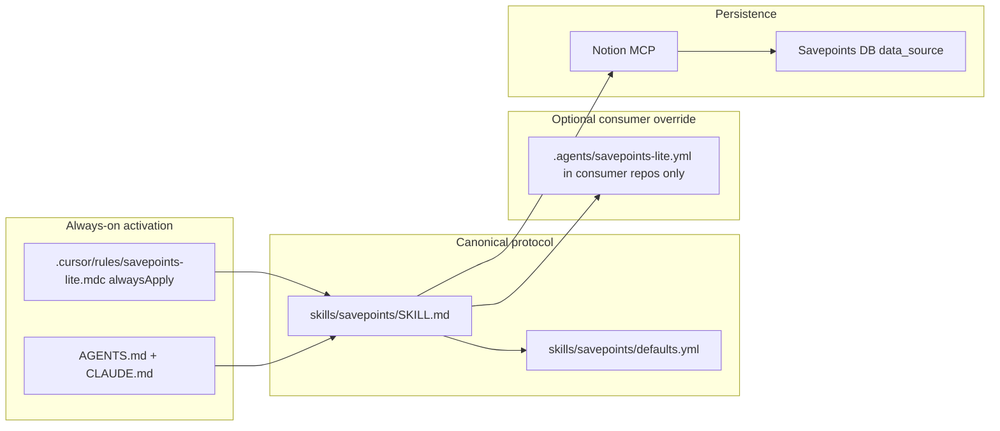

# Savepoints Lite v1 — implementation plan

## Goals and non-goals

**In scope:** Append-only session logging via **Notion MCP** (`notion-create-pages`), triggered by agent instructions (not hooks), distributable as a **Cursor plugin** with canonical skill at [`skills/savepoints/SKILL.md`](skills/savepoints/SKILL.md).

**Out of scope:** Everything listed in the product brief (read/recovery, queues, hooks, custom MCP, local spool, summarization, metrics).

**Contrast with [`multipliers-dev/savepoints`](https://github.com/multipliers-dev/savepoints):** Full Savepoints optimizes for *durable learnings* (five-check rubric, `emit-learning`, hooks, Postgres). Lite optimizes for *activity/session narrative* (what/decisions/threads/errors) with **immediate, frequent Notion appends** and **no host adapters**.

---

## Architecture



**Design principle:** One canonical write protocol in the skill; activation layers are **thin pointers** (same pattern as full Savepoints: [`.cursor/rules/emit-savepoints.mdc`](https://github.com/multipliers-dev/savepoints/blob/main/.cursor/rules/emit-savepoints.mdc) + [`AGENTS.md`](https://github.com/multipliers-dev/savepoints/blob/main/AGENTS.md)). Do **not** set `disable-model-invocation: true` on the skill (unlike Renovate/editor slash-only skills) — Lite must remain discoverable when the model reads skill context.

**Write path:** Notion MCP only (no hub CLI, no API token in repo). Auth stays with the operator’s Notion MCP connection.

---

## Notion destination and page shape

### Configuration (non-secret, skill-bundled default)

| Key | Default value |
| --- | --- |
| `notion.data_source_id` | `822cbc89-7c89-4863-af3a-2fe0cd8ab56e` |
| `notion.database_id` | `05e4c804-1380-4ea2-8eb6-30027aa05fe4` (documentation / `notion-fetch` URL only; **parent for creates is `data_source_id`**) |

**Resolution order** (document in skill):

1. [`skills/savepoints/defaults.yml`](skills/savepoints/defaults.yml) — **canonical default** for all consumers (shared Savepoints database).  
2. Optional workspace [`.agents/savepoints-lite.yml`](.agents/savepoints-lite.yml) **only when a consumer repo needs a different destination** (fork, staging DB, etc.).

No env vars for v1. The `savepoints-lite` hub repo does **not** commit `.agents/savepoints-lite.yml` — that would duplicate `defaults.yml` with no benefit. Ship [`.agents/savepoints-lite.template.yml`](.agents/savepoints-lite.template.yml) (or equivalent under `templates/consumer/`) as copy-paste documentation for overrides only.

**Established property contract** (document in skill; no mandatory fetch before first write):

| Property | Type | Notes |
| --- | --- | --- |
| Name | Title | Exact Notion property name: `Name` |
| Repository | Text | |
| Agent | Text | |
| Session ID | Text | Omit when unknown |

`notion-fetch` on the data source is **not** a session preflight. Use fetch only when: the create tool’s error or docs require schema discovery, a property mismatch occurs, or the agent needs to confirm renamed columns. Do **not** change Notion schema unless fetch proves incompatibility.

For page body Markdown, read `notion://docs/notion-flavored-markdown-spec` once per agent when first composing content (resource/`notion-fetch` on that URI) — not a database schema fetch.

### MCP write sequence (per Savepoint event)

**Per event, not per session:** On each trigger, attempt the write. There is no “give up for the rest of the session” latch if an earlier attempt failed (important for Cloud, where Notion MCP may connect mid-session).

1. **Create (every event):** Call the connected Notion MCP create-page tool (e.g. `notion-create-pages`) with:
   - `parent`: `{ "type": "data_source_id", "data_source_id": "<resolved>" }`
   - `pages[0].properties`: map using the established property contract above (and fetch output **only** if a prior create failed with a property/schema error)
   - `pages[0].content`: Notion-flavored Markdown per the four body sections
   - **`allow_async`: `false` by default** when the tool accepts it — wait for a synchronous success result (page id / URL in the response) before treating persistence as done
2. **If the tool rejects sync create or returns an async task:** poll with `notion-get-async-task` (or equivalent) only within a **bounded** window — e.g. at most **two** follow-up polls or until a terminal state (`succeeded` / failed), whichever comes first. **Do not poll indefinitely**; Savepoint confirmation must not block completion of the user’s primary work. If still pending after the bound, report **queued / unconfirmed** and continue — do not claim success
3. **On failure (unavailable MCP, auth error, create error):** one-sentence **in-chat** report for **this event**, **no retry queue**, continue primary work; **later independent work events** may attempt writes again

### Metadata rules

| Property | Source |
| --- | --- |
| **Name** (title) | Short event label: `{repository} — {verb phrase}` (e.g. `savepoints-lite — planned v1 skill structure`) |
| **Repository** | `owner/repo` from `git remote get-url origin`, else workspace folder name |
| **Agent** | Best available host label: `Cursor Agent`, `Claude Code`, `Cursor Cloud Agent`, etc.; never invent vendor names |
| **Session ID** | Include only when the host exposes a stable id (e.g. conversation/composer id in context); **omit property or leave empty** — do not fabricate |

### Body sections (omit empty)

Use level-2 headings exactly:

- `## What was done`
- `## Decisions made`
- `## Open threads`
- `## Errors`

Each trigger produces a **new page** — no updates, dedupe, or batching.

### Trigger contract (immediate writes)

The skill must require a Savepoint **in the same turn** when any of these occur:

- A coherent unit of work completes (feature slice, fix, doc pass, verification run).  
- A significant decision is made (architecture, scope, tradeoff).  
- The agent switches tasks or user changes direction.  
- An error is hit or resolved **in the primary task** (tooling, build, test, user-visible failure) — record under **Errors** in the Savepoint for that work event.

**Explicit anti-patterns:** session-end only, “remember to savepoint at the end,” debouncing, consolidating multiple events into one page.

### Failure behavior

On create error or unconfirmed async: one-sentence user-visible report (tool name + error summary, or “queued — not confirmed”), **no retry queue**, resume primary task. **Do not** disable subsequent Savepoint attempts in the same session.

**Anti-loop (failed Savepoint writes):** A **failed Savepoint write** (Notion MCP unavailable, auth error, create error, or unconfirmed async) is **not** an error event that triggers another Savepoint. Report the persistence failure in chat and continue the primary task. Do **not** chain “write failed → new Savepoint to log the failure → write failed again.” Only a **later, independent** work trigger (completed task, decision, task switch, or primary-task error) may attempt another Savepoint.

---

## Skill structure

```
skills/savepoints/
  SKILL.md              # Canonical protocol (frontmatter name: savepoints or savepoints-lite — pick one, use consistently in slash + docs)
  defaults.yml          # Bundled notion.data_source_id (+ database_id for humans)
  verification.md       # Manual checklists — introduced in adopt-and-verify slice only (not protocol-core)
skills/README.md        # Index (short; mirror editorial-workflow/skills/README.md tone)
```

**[`SKILL.md`](skills/savepoints/SKILL.md) sections (suggested):**

1. Purpose and v1 boundaries  
2. When to write (trigger list)  
3. Config resolution  
4. Metadata derivation  
5. Notion MCP steps (per-event create, optional fetch on mismatch, sync confirmation) with example payload shape (properties + content template)  
6. Failure handling  
7. What **not** to do (read/update/batch/hooks; **no Savepoint-on-Savepoint-failure loop**)  
8. In **adopt-and-verify** only: add link to [`verification.md`](skills/savepoints/verification.md) (do not link from `SKILL.md` in protocol-core — file does not exist yet)

Optional small companion [`skills/savepoints/notion-payload.md`](skills/savepoints/notion-payload.md) only if `SKILL.md` grows unwieldy — prefer keeping v1 in one file.

---

## Activation and distribution

### In-repo activation (this repository)

| File | Role |
| --- | --- |
| [`.cursor/rules/savepoints-lite.mdc`](.cursor/rules/savepoints-lite.mdc) | `alwaysApply: true` — short contract: triggers, “read skill before write,” fail-open |
| [`AGENTS.md`](AGENTS.md) | Savepoints Lite section: mandatory logging behavior, link to skill, Cloud reminder (no hooks) |
| [`CLAUDE.md`](CLAUDE.md) | `@AGENTS.md` or equivalent one-line import for Claude Code |

**Why always-on rule:** Cursor plugins distribute **skills**, not project rules ([editorial-workflow](https://github.com/multipliers-dev/editorial-workflow) / [renovate-workflow](https://github.com/multipliers-dev/renovate-workflow) ship `"skills": "./skills"` only). Continuous behavior requires a **committed** `alwaysApply` rule in each repo that should log (including this repo).

### Plugin / marketplace (distribution)

Follow renovate’s dual manifest pattern:

| File | Role |
| --- | --- |
| [`plugin.json`](plugin.json) | Agent Plugins 1.0 portable manifest (name, version, repo metadata) |
| [`.cursor-plugin/marketplace.json`](.cursor-plugin/marketplace.json) | Single-plugin marketplace for “Add from GitHub” |
| [`.cursor-plugin/plugin.json`](.cursor-plugin/plugin.json) | `"skills": "./skills"` |

**Consumer adoption** (new [`docs/adopt.md`](docs/adopt.md), modeled on [renovate-workflow/docs/adopt.md](https://github.com/multipliers-dev/renovate-workflow/blob/main/docs/adopt.md)):

1. Import `https://github.com/multipliers-dev/savepoints-lite` as marketplace; install **savepoints-lite** plugin.  
2. Copy [`templates/consumer/.cursor/rules/savepoints-lite.mdc`](templates/consumer/.cursor/rules/savepoints-lite.mdc) into the consumer repo (or merge equivalent prose).  
3. **Only if overriding the shared database:** copy template → `.agents/savepoints-lite.yml` in the consumer repo (not required for default adopters).  
4. Add a short pointer in consumer `AGENTS.md` / `CLAUDE.md`.  
5. Ensure **Notion MCP** is connected in that environment.

**Not in v1:** Listing inside `cursor-team-marketplace` (optional follow-up PR there).

### Claude Code portability

- **Same skill file** is canonical.  
- Adoption doc: install plugin if supported, else vendor `skills/savepoints/` into the project’s Claude skills path and replicate the always-on instruction via `CLAUDE.md` + `AGENTS.md`.  
- Verification item: one real task in Claude Code → confirm row in shared Notion DB.

---

## Bootstrap slimming (why change the template)

Current [`src/index.ts`](src/index.ts) is a placeholder (`console.log("ready")`). v1 has **no runtime**.

**Proposed changes:**

| Remove / change | Rationale |
| --- | --- |
| Remove `src/`, `tsx`, `typescript`, `dev`/`start` scripts | No executable product code |
| Replace with [`scripts/verify-protocol-files.sh`](scripts/verify-protocol-files.sh) | CI/pre-commit guard: required paths exist, `defaults.yml` contains UUIDs, `plugin.json` / `.cursor-plugin/*.json` parse |
| [`package.json`](package.json) scripts: `test` + `typecheck` → both run verifier (keeps Husky/CI contract without a fake TS app) | Preserves team-harness hook story with minimal churn |
| Update [`README.md`](README.md) | Product description and Notion MCP prerequisite only — **no** link to `docs/adopt.md` until that file exists in adopt-and-verify |

**Keep unchanged unless required:** [`.cursor/hooks.json`](.cursor/hooks.json), [`.cursor/environment.json`](.cursor/environment.json), Husky prepare scripts — Lite explicitly does **not** add Savepoints hooks.

---

## Implementation slices (merge-safe)

Recommended **two implementation PRs** + docs closure. Each slice is **merge-safe on its own** — no cross-slice links to files that do not exist yet on `main`.

### Slice `protocol-core` (Open PR only)

**Deliverables:**

- `skills/savepoints/SKILL.md`, `skills/savepoints/defaults.yml`, `skills/README.md` — **not** `verification.md` (slice 2)  
- Override template only (e.g. `.agents/savepoints-lite.template.yml` or under `templates/consumer/`) — **no** committed `.agents/savepoints-lite.yml` in this repo  
- `.cursor/rules/savepoints-lite.mdc`  
- `AGENTS.md`, `CLAUDE.md`, [`README.md`](README.md) — product overview and Notion MCP prerequisite; **do not** link to [`docs/adopt.md`](docs/adopt.md) (file does not exist until slice 2)  
- `plugin.json`, `.cursor-plugin/*`  
- Bootstrap slim + `scripts/verify-protocol-files.sh`  

**Acceptance:**

- `npm test` and `npm run typecheck` pass (verifier only)  
- `verify-protocol-files.sh` checks protocol-core artifacts only (`SKILL.md`, `defaults.yml`, plugin manifests, rule) — **must not** require `verification.md` or `docs/adopt.md`  
- Root `README.md` contains **no** reference to `docs/adopt.md` (grep / verifier assertion acceptable)  
- No new hooks beyond existing git-hook stack  

### Slice `adopt-and-verify` (Open PR only)

**Deliverables:**

- [`docs/adopt.md`](docs/adopt.md) **created in this slice** (first appearance in repo)  
- **Same PR:** update root [`README.md`](README.md) to add an adoption section linking to [`docs/adopt.md`](docs/adopt.md) (relative path, e.g. `[docs/adopt.md](docs/adopt.md)`) — link lands in the **same commit** as the adopt doc so the slice stays merge-safe  
- [`templates/consumer/`](templates/consumer/) (rule snippet + optional AGENTS.md fragment)  
- [`skills/savepoints/verification.md`](skills/savepoints/verification.md) **created here** with checklists; update `SKILL.md` to link it  

**Acceptance:**

- Adopt doc describes Cursor + Claude paths  
- `README.md` links to `docs/adopt.md` and the target file exists in this PR  
- Manual verification section clearly labeled  
- Extend `verify-protocol-files.sh` to require `verification.md` and `docs/adopt.md` in this slice (optional tightening)  

### `plan-closure` (docs-only, after slices merge)

- `# Shipped` note, archive plan under `.cursor/plans/archive/`, mark `plan-closure` completed.

---

## Verification

### Automatable (CI / local)

| Check | Mechanism |
| --- | --- |
| Skill + plugin artifacts exist | `scripts/verify-protocol-files.sh` (protocol-core scope; add `verification.md` in adopt-and-verify) |
| JSON manifests parse | same script (`node -e` or `python -m json.tool`) |
| Default data source id unchanged | grep/assert in script |
| No accidental hook additions | script asserts `.cursor/hooks.json` has no savepoints-specific hooks |

**Do not** build an “agent compliance test framework.”

### Manual (real agent sessions — required for behavioral claims)

Use [`skills/savepoints/verification.md`](skills/savepoints/verification.md):

| # | Scenario | Pass criteria |
| --- | --- | --- |
| 1 | **Discoverability** | Fresh Cursor chat in `savepoints-lite`; agent loads rule/skill without user saying “use savepoints” |
| 2 | **Implicit logging** | Complete a small doc edit; **≥1** Notion row appears without user reminder |
| 3 | **Metadata** | Row has correct `Repository`, `Agent`, sensible `Name`; `Session ID` only if host provided |
| 4 | **Content** | Body includes appropriate sections; empty sections omitted |
| 5 | **Multi-write** | Same session: decision + completed task → **≥2** rows |
| 6 | **Fail-open per event** | With MCP unavailable, agent finishes task and reports write failure; after MCP is available again in the **same session**, a later trigger still produces a row |
| 6b | **Persistence honesty** | Agent does not claim “saved to Notion” unless sync create succeeded or bounded async poll reached `succeeded` |
| 6c | **No Savepoint-on-failure loop** | After a failed Savepoint write, agent reports in chat only; does not immediately open another Savepoint solely to record that failure |
| 7 | **Claude Code** | Repeat 2–5 in Claude with same DB |
| 8 | **No hooks** | Confirm logging still works with only instructions (no new lifecycle hooks) |

Record manual run date + Notion page URLs in PR description or verification checklist (not committed secrets).

---

## Compatibility limits and open decisions

| Topic | Limitation / decision |
| --- | --- |
| **Enforcement** | Instructions + `alwaysApply` rule are **best-effort**; models can still skip writes — v1 accepts this by design (no hooks). |
| **Plugin vs rule** | Installing the plugin alone does **not** enable continuous logging; consumers must add the rule (document loudly in `docs/adopt.md`). |
| **Cloud Agents** | Rely on `AGENTS.md` (+ optional future `.cursor/CLOUD.md` one-pager); rules may load but must not assume hook delivery. |
| **Session ID** | Inconsistent across hosts; optional by design. |
| **Notion MCP variance** | Tool names may differ by client (`CallDynamicTool` vs `notion-create-pages`); skill should say “use the connected Notion MCP create-page tool” and use documented property names unless a create error forces fetch. |
| **Async creates** | Prefer `allow_async: false`; when async is unavoidable, **bounded** poll (no indefinite wait); then success, terminal failure, or unconfirmed — never imply persistence on queue alone. |
| **Skill name** | **Decision:** use `savepoints` (slash `/savepoints`) vs `savepoints-lite` — recommend **`savepoints`** for ergonomics with repo name `savepoints-lite` disambiguating the product. |
| **cursor-team-marketplace** | **Deferred:** optional third PR to add marketplace entry after v1 proven. |

---

## Recommended execution authority

| Slice | Recommended authority | Agent instruction |
| --- | --- | --- |
| Plan review (this PR) | Plan-only PR | Do not begin implementation slices. Stop after opening the PR. |
| `protocol-core` | Open PR only | Do not merge. Stop after opening the PR. |
| `adopt-and-verify` | Open PR only | Do not merge. Stop after opening the PR. |
| `plan-closure` | Open PR only | Do not merge. Stop after opening the PR. |

---

## Agent prompts (copy/paste for Cursor)

### protocol-core

```text
@.cursor/plans/2026-10-27-savepoints-lite-v1.plan.md

Implement slice protocol-core only. Do not start adopt-and-verify or plan-closure.

Authority: Open PR only — implement and open the PR; do not merge.

Topology: start from latest origin/main; branch represents only this slice; PR base must be main.

Deliverables: per plan — skill, defaults.yml (no committed .agents in hub), override template, alwaysApply rule, AGENTS.md/CLAUDE.md, plugin manifests, bootstrap slim, verify-protocol-files.sh, README without any docs/adopt.md link. Mark protocol-core completed in plan frontmatter in this PR.

Verification: npm test && npm run typecheck. Do not create Notion test rows unless explicitly asked.
```

### adopt-and-verify

```text
@.cursor/plans/2026-10-27-savepoints-lite-v1.plan.md

Implement slice adopt-and-verify only. Prerequisite: protocol-core merged. Do not archive the plan.

Authority: Open PR only — implement and open the PR; do not merge.

Topology: start from latest origin/main; branch represents only this slice; PR base must be main.

Deliverables: docs/adopt.md (new), README.md adoption link to docs/adopt.md in the same PR, templates/consumer/, skills/savepoints/verification.md. Mark adopt-and-verify completed in plan frontmatter in this PR.

Verification: npm test && npm run typecheck; manual checklist documented (no required Notion writes in CI).
```

### plan-closure

```text
@.cursor/plans/2026-10-27-savepoints-lite-v1.plan.md

Execute only plan-closure.

Authority: Open PR only — docs-only archive PR; do not merge.

Prerequisites: protocol-core and adopt-and-verify merged to main.

Deliverables: # Shipped note, move plan to .cursor/plans/archive/, mark plan-closure completed.

Verification: confirm prerequisite PRs merged.
```
