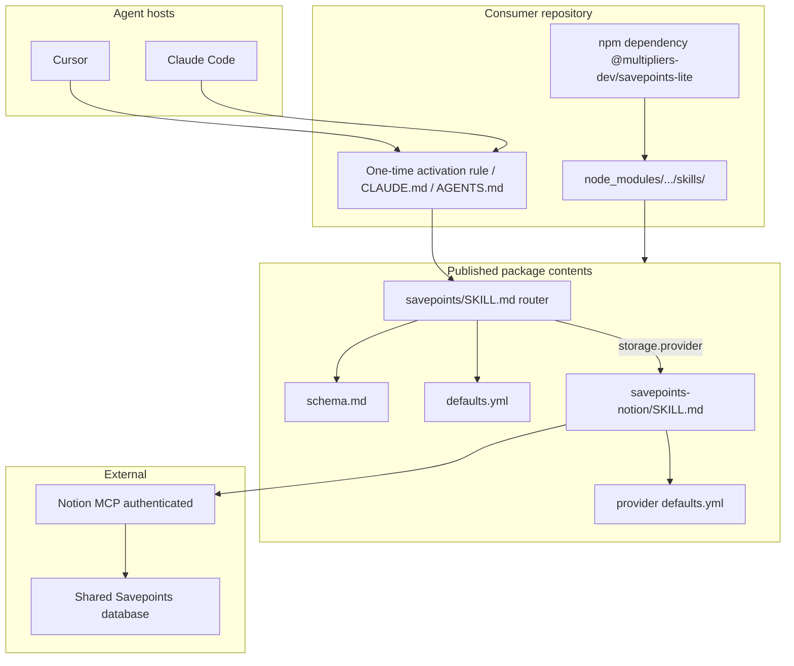

# Savepoints Lite v1 — implementation plan

## Goals and non-goals

**In scope:** Append-only session logging via an **npm-distributed** router skill ([`skills/savepoints/SKILL.md`](skills/savepoints/SKILL.md)) that delegates to provider skills (`savepoints-notion` in v1), using the consumer’s **existing Notion MCP** — instruction-only, no executable persistence runtime.

**Out of scope:** Everything in the product brief (read/recovery, queues, Savepoints capture hooks, custom MCP server, local spool, summarization, metrics) and **§ Scope exclusions** below. **Deferred:** `savepoints-postgres`, connection management, schema migrations, dynamic provider discovery, multi-provider writes, Cursor marketplace packaging.

**Contrast with [`multipliers-dev/savepoints`](https://github.com/multipliers-dev/savepoints):** Full Savepoints optimizes for *durable learnings* (five-check rubric, `emit-learning`, lifecycle hooks, Postgres submit workers). Lite optimizes for *activity/session narrative* with **immediate appends** and **no lifecycle/host automation** — with a **router → provider skill** split so *what* to record, *where* (provider selection), and *how* (MCP writes) stay separated.

---

## Architecture



| Layer | v1 responsibility |
| --- | --- |
| **Activation** | Triggers, “read **router** skill,” fail-open |
| **Router** [`skills/savepoints/`](skills/savepoints/) | Event detection, build Savepoint, read `storage.provider`, **load and invoke** matching provider skill, handle `success` / `failure` / `unconfirmed` — **no** Notion properties or SQL |
| **Provider** [`skills/savepoints-notion/`](skills/savepoints-notion/) | Map Savepoint → Notion, MCP write, bounded async confirmation, return outcome — **does not** decide when to Savepoint |
| **Future** `skills/savepoints-postgres/` | Postgres MCP mapping only (not shipped in v1) |
| **Distribution** | [`@multipliers-dev/savepoints-lite`](package.json) npm package — **no** Cursor marketplace; consumers **must not** vendor/copy skills |
| **Runtime** | None — package ships instructions and defaults only |

**Design principle:** Router owns **what** and **when**; provider selection is static config; provider skills own **how** to persist. Consumer activation points agents at the **installed** router `SKILL.md` under `node_modules`. Do **not** set `disable-model-invocation: true` on router or v1 provider skills.

**Installed paths (consumer):**

```text
node_modules/@multipliers-dev/savepoints-lite/skills/savepoints/SKILL.md
node_modules/@multipliers-dev/savepoints-lite/skills/savepoints-notion/SKILL.md
```

Router and provider skills must reference **package-relative** paths from that install root. **`node_modules` must exist** in the agent execution environment (after `npm install` / `npm ci`).

**npm does not register skills** with Cursor or Claude native discovery — activation templates (**adopt-and-verify**) tell agents **when** to read the router and **where** the installed file lives.

**Provider resolution (v1):** `storage.provider: notion` → load provider skill from the same package install. Unknown or missing provider → report misconfiguration; **no** dynamic discovery or fallback provider.

**Caveat:** Routing is **instruction-based** — behavioral verification (**adopt-and-verify**) must confirm delegation to `savepoints-notion`, reads from `node_modules`, and Notion MCP writes.

---

## Savepoint protocol (provider-neutral)

Document in [`schema.md`](skills/savepoints/schema.md); router [`SKILL.md`](skills/savepoints/SKILL.md) references it. Independent of Notion, Postgres, or any single MCP.

### Canonical Savepoint fields

Provider-neutral contract ([`schema.md`](skills/savepoints/schema.md)). No additional required metadata beyond these fields:

```yaml
title: string
repository: string
agent: string
session_id: optional string  # omit when unknown

content:
  what_was_done: optional string
  decisions_made: optional string
  open_threads: optional string
  errors: optional string
```

Example:

```yaml
title: "multipliers-dev/portfolio — Implemented authentication"
repository: multipliers-dev/portfolio
agent: Cursor Agent

content:
  what_was_done: Added authentication middleware
  decisions_made: Selected JWT authentication
  open_threads: Token rotation
```

### Metadata derivation (protocol)

| Field | Source |
| --- | --- |
| `title` | Short event label: `{repository} — {verb phrase}` |
| `repository` | `owner/repo` from `git remote get-url origin`, else workspace folder name |
| `agent` | Best available host label; never invent vendor names |
| `session_id` | Host-provided id only; do not fabricate |

### Content sections (protocol)

Map to persisted body under **provider skill** formatting rules. Omit empty sections:

- `what_was_done`
- `decisions_made`
- `open_threads`
- `errors`

Each trigger produces **one new record** — no updates, dedupe, or batching.

### `append` contract (behavioral, not code)

After the router assembles a Savepoint, it **delegates** to the resolved provider skill. The provider returns an outcome; the router surfaces it to the user when needed:

```text
append(savepoint) → success | failure | unconfirmed
```

**Router:** invoke provider skill with the Savepoint; do not perform MCP calls itself.

**Provider skill** must:

- Create a **new** record without modifying previous records.
- Preserve Savepoint content and metadata per provider mapping.
- Confirm persistence when the provider supports it (`success`); otherwise return `unconfirmed`.
- On `failure`, return `failure` so the router can report in chat without blocking primary work.

**Per event, not per session:** Each work trigger → one Savepoint → one provider delegation. No session-wide latch after failure. **No retry queue.**

---

## Router and provider skills

### Package layout (published under `skills/`)

Shipped inside `@multipliers-dev/savepoints-lite` (see **npm distribution**):

```
skills/
├── savepoints/                    # Router
│   ├── SKILL.md
│   ├── defaults.yml               # storage.provider only
│   └── schema.md
├── savepoints-notion/             # Provider (v1)
│   ├── SKILL.md
│   └── defaults.yml               # destination.data_source_id
└── README.md
```

**Future:** `skills/savepoints-postgres/` — not in v1. Add only a new provider skill + defaults; router `schema.md` unchanged.

### Router [`skills/savepoints/SKILL.md`](skills/savepoints/SKILL.md)

Responsible for:

1. Recognizing meaningful work events (trigger contract below).  
2. Building a provider-neutral Savepoint per [`schema.md`](skills/savepoints/schema.md).  
3. Reading `storage.provider` from router [`defaults.yml`](skills/savepoints/defaults.yml).  
4. **Loading the matching provider skill** from the **same npm package install** (e.g. `notion` → `../savepoints-notion/SKILL.md` relative to router skill path) and delegating persistence.  
5. Handling the provider outcome (`success` / `failure` / `unconfirmed`) and anti-loop failure reporting.

The router **must not** document Notion page properties, Postgres table schemas, or MCP tool parameters.

### Provider [`skills/savepoints-notion/SKILL.md`](skills/savepoints-notion/SKILL.md)

Responsible for:

- Accepting a Savepoint from the router (does **not** decide when Savepoints are created).  
- Loading provider [`defaults.yml`](skills/savepoints-notion/defaults.yml) for destination.  
- Translating the Savepoint into Notion properties and page body.  
- Calling Notion MCP (`notion-create-pages`, etc.).  
- Bounded async confirmation (`allow_async: false` by default; at most **two** poll follow-ups).  
- Returning `success` | `failure` | `unconfirmed` to the router.

| Topic | Contents |
| --- | --- |
| Destination | `parent.data_source_id` = `destination.data_source_id` from provider defaults |
| Property mapping | `title` → `Name`; `repository` → `Repository`; `agent` → `Agent`; `session_id` → `Session ID` (omit when unknown) |
| Body | Notion-flavored Markdown sections; read markdown spec once when first composing |
| Schema fetch | `notion-fetch` **only** on property mismatch or tool-required discovery — not a session preflight |

Shared Notion database id for humans: `05e4c804-1380-4ea2-8eb6-30027aa05fe4`. Do **not** change Notion schema unless fetch proves incompatibility.

### Configuration (split)

**Router** ([`skills/savepoints/defaults.yml`](skills/savepoints/defaults.yml)):

```yaml
storage:
  provider: notion
```

**Notion provider** ([`skills/savepoints-notion/defaults.yml`](skills/savepoints-notion/defaults.yml)):

```yaml
destination:
  data_source_id: "822cbc89-7c89-4863-af3a-2fe0cd8ab56e"
```

**Resolution order** (static; no dynamic discovery):

| Precedence | Location | Overrides |
| --- | --- | --- |
| 1 (highest) | Consumer repo [`.agents/savepoints-lite.yml`](.agents/savepoints-lite.yml) | `storage.provider` only |
| 2 | Consumer repo [`.agents/savepoints-notion.yml`](.agents/savepoints-notion.yml) | Notion `destination.data_source_id` only |
| 3 (default) | Package [`skills/savepoints/defaults.yml`](skills/savepoints/defaults.yml) and [`skills/savepoints-notion/defaults.yml`](skills/savepoints-notion/defaults.yml) under `node_modules` | Shared Savepoints database |

Consumers **need not** copy default YAML — install npm package only unless overriding provider or destination. Hub repo does not commit live `.agents/*.yml` (templates ship in **adopt-and-verify**).

**Unsupported `storage.provider`:** report misconfiguration; do not guess or fall back.

No env vars for v1. Auth remains with each provider’s MCP (Notion MCP for v1).

### Future: `savepoints-postgres`

New provider skill + `defaults.yml` only; router provider map gains `postgres` → `savepoints-postgres/SKILL.md`. Router `schema.md` and event logic should not require changes.

### Trigger contract (immediate writes)

The skill must require a Savepoint **in the same turn** when any of these occur:

- A coherent unit of work completes (feature slice, fix, doc pass, verification run).  
- A significant decision is made (architecture, scope, tradeoff).  
- The agent switches tasks or user changes direction.  
- An error is hit or resolved **in the primary task** (tooling, build, test, user-visible failure) — record under **Errors** in the Savepoint for that work event.

**Explicit anti-patterns:** session-end only, “remember to savepoint at the end,” debouncing, consolidating multiple events into one page.

### Failure behavior

On create error or unconfirmed async: one-sentence user-visible report (tool name + error summary, or “queued — not confirmed”), **no retry queue**, resume primary task. **Do not** disable subsequent Savepoint attempts in the same session.

**Anti-loop (failed Savepoint writes):** A **failed `append`** (provider MCP unavailable, auth error, create error, or unconfirmed async) is **not** an error event that triggers another Savepoint. Report the persistence failure in chat and continue the primary task. Do **not** chain “write failed → new Savepoint to log the failure → write failed again.” Only a **later, independent** work trigger may attempt another `append`.

---

## Skill structure

See **Router and provider skills** above. Summary:

| Path | Role |
| --- | --- |
| [`skills/savepoints/SKILL.md`](skills/savepoints/SKILL.md) | Router — events, Savepoint build, provider resolve, delegate |
| [`skills/savepoints/schema.md`](skills/savepoints/schema.md) | Canonical Savepoint contract |
| [`skills/savepoints/defaults.yml`](skills/savepoints/defaults.yml) | `storage.provider` |
| [`skills/savepoints-notion/SKILL.md`](skills/savepoints-notion/SKILL.md) | Notion MCP persistence (v1) |
| [`skills/savepoints-notion/defaults.yml`](skills/savepoints-notion/defaults.yml) | `destination.data_source_id` |
| [`skills/savepoints/verification.md`](skills/savepoints/verification.md) | Manual checklists — **adopt-and-verify only** |
| [`skills/README.md`](skills/README.md) | Index of router + providers |

**Router `SKILL.md` sections (suggested):** purpose; triggers; `schema.md` reference; metadata derivation; provider resolution table; delegation steps; outcomes and anti-loop; forbidden (provider MCP details).

**Provider `savepoints-notion/SKILL.md` sections (suggested):** input Savepoint contract; load provider defaults; Notion mapping; MCP write + bounded confirmation; return outcome; forbidden (event detection).

---

## npm distribution

Follow [`@multipliers-dev/plan-validator`](https://www.npmjs.com/package/@multipliers-dev/plan-validator) publishing conventions (standalone repo; instruction-only package differs from plan-validator’s compiled `dist/` + `bin`):

| Concern | Plan |
| --- | --- |
| **Name** | `@multipliers-dev/savepoints-lite` (replace hub placeholder name; **not** `private`) |
| **`private`** | Remove `"private": true` or set `"private": false` before first publish |
| **Versioning** | Semantic versioning; bump on publish |
| **`publishConfig`** | `access: public`, `provenance: true` (match plan-validator scoped public package) |
| **`files`** | Ship `skills/**`, `README.md`, `docs/**` (after **documentation** slice), and any packaged config templates — **no** `bin`, **no** compiled runtime |
| **`engines`** | Node `>=22` (align with plan-validator floor) |
| **Install** | Consumer `devDependency` (or `dependency`): declare an **exact semver** in `package.json` (e.g. `"@multipliers-dev/savepoints-lite": "1.0.0"`) — not a floating range for production adoption |
| **Verify publish** | `npm pack --dry-run` (and/or `prepack` script) asserts expected paths land in tarball |
| **Reproducibility** | **npm is the single source of truth** for installed skill file versions: committed **lockfile**, `npm ci` in CI and reproducible environments, **Renovate** (or equivalent) PRs to bump the dependency — **no** separate skill-copy or skill-update mechanism; **activation text unchanged** across version bumps (stable `node_modules` path pattern) |

**Out of scope:** installation CLI, bootstrap script, executable Savepoints runtime, custom MCP server.

**Publication verification:** **protocol-core** confirms tarball contains router + Notion provider skills and default YAML. **documentation** extends verify/tests so the packed artifact also includes README, `docs/architecture.md`, and `docs/publishing.md`. **npm publish** is an **operator-controlled release gate** (**npm-publication**) after **documentation** merges — not an implementation PR unless explicitly authorized.

### Publication and adoption sequence

```text
protocol-core merged to main
    → documentation PR merges (durable README + docs/architecture.md + docs/publishing.md in tarball)
    → npm-publication (operator gate: verify, authorize, publish @1.0.0, record evidence)
    → adopt-and-verify (consumer pins published registry version)
    → plan-closure
```

| Phase | What is validated |
| --- | --- |
| **protocol-core** | Package is publishable; `npm pack` / dry-run proves skills + defaults (+ minimal README) |
| **documentation** | Public landing README; architecture + publishing docs; `files` includes `docs/**`; verify/tests assert doc paths in tarball — **no** registry publish |
| **npm-publication** | Clean checkout; `npm ci`, `npm test`, `npm run verify`, `npm pack --dry-run`; operator auth + explicit publish authorization; `@multipliers-dev/savepoints-lite@1.0.0` on registry with provenance; clean temp consumer install |
| **Between slices (optional)** | Local `npm pack` + `file:` or packed tarball install for **early smoke** only — does **not** satisfy adoption verification |
| **adopt-and-verify** | [`fixtures/consumer/`](fixtures/consumer/) and manual agent checks use the **published registry version** pinned in `package.json` + lockfile (`npm ci`) |

Do **not** treat `file:` workspace links as the acceptance path for **adopt-and-verify**; they may help developers before the first publish, but **adopt-and-verify** must confirm the real npm distribution path.

**Hard prerequisite:** **adopt-and-verify** does not start until **npm-publication** completes successfully (registry install verified, evidence recorded).

---

## Agent activation (consumer; adopt-and-verify)

npm install alone does **not** enable Savepoints. One-time **activation** per consumer repo (templates in **adopt-and-verify**). Activation files are **thin** — they must **not** duplicate the full protocol.

Establish only:

1. **When** the router must be consulted (same triggers as router skill).  
2. **Where** the installed router lives: `node_modules/@multipliers-dev/savepoints-lite/skills/savepoints/SKILL.md`.  
3. **That** the agent must follow the router and the configured provider skill from the same package.

| Surface | Mechanism |
| --- | --- |
| **Cursor** | Commit [`templates/consumer/.cursor/rules/savepoints-lite.mdc`](templates/consumer/.cursor/rules/savepoints-lite.mdc) → consumer `.cursor/rules/` (`alwaysApply: true`) |
| **Claude Code** | Short [`CLAUDE.md`](CLAUDE.md) pointer (preserve existing content; **append** Savepoints section) |
| **Other agents** | [`AGENTS.md`](AGENTS.md) pointer where applicable (preserve existing content) |

[`docs/adopt.md`](docs/adopt.md): **documentation** ships an initial stub (prerequisites, pinned install, non-activation, router path, honest integration-support status, architecture link). **adopt-and-verify** expands it with pinned registry workflow detail, Renovate-friendly updates, activation templates, fixture-backed verification, and recorded Cursor/Claude behavioral results. **README** links to `docs/adopt.md` from the first public tarball.

**Hub repo (`savepoints-lite`):** optional **hub dogfooding** (this repository installing the published package + activation) is separate from [`fixtures/consumer/`](fixtures/consumer/) — see **Consumer fixture**. **protocol-core** updated hub **Commands / CI / pre-commit** in [`AGENTS.md`](AGENTS.md); it does **not** add Savepoints activation templates or Savepoints-specific `AGENTS.md` / `CLAUDE.md` sections (deferred to **adopt-and-verify**).

### Consumer fixture (`fixtures/consumer/` — adopt-and-verify)

Disposable minimal consumer checkout used **only** for manual behavioral verification (not production adoption docs):

| Aspect | Plan |
| --- | --- |
| **Location** | [`fixtures/consumer/`](fixtures/consumer/) — minimal `package.json`, lockfile, activation copied from [`templates/consumer/`](templates/consumer/) |
| **vs hub** | **Separate** from hub dogfooding on the package repo root; fixture simulates an external consumer |
| **Dependency** | Pinned **published** `@multipliers-dev/savepoints-lite@<version>` from the npm registry (not `file:`) |
| **Paths** | Manual checks confirm canonical skills under `fixtures/consumer/node_modules/@multipliers-dev/savepoints-lite/skills/` |
| **Agents** | Manual Cursor and Claude Code sessions run **in or against** the fixture per [`verification.md`](skills/savepoints/verification.md) |
| **Notion** | Rows in the shared production database **only** with explicit operator authorization |
| **CI** | Optional layout checks only (e.g. fixture has lockfile + dependency pin); **no** agent behavior in CI |

Keep fixture minimal — no extra services, scripts, or frameworks beyond install + activation stubs.

---

## Reliability (v1 — preserved)

Append-only; one Savepoint per meaningful completed event; immediate writes (no session-end batching); no local fallback, retry queue, deduplication, or retrieval; no custom MCP; no executable logging runtime; fail-open on persistence failure; never claim persistence without confirmation; **failed Savepoint write must not trigger another Savepoint**; prefer synchronous MCP create with **bounded** async polling (at most two follow-ups, then `unconfirmed`).

---

## Scope exclusions (v1)

Do not implement: PostgreSQL provider; SQLite storage; custom MCP server; custom logging runtime; installation CLI; **Savepoints activity-capture hooks or lifecycle handlers** (see **Repository bootstrap** — unrelated repo Git/Husky/Cursor bootstrap hooks stay); background workers; local queue/spool; multiple simultaneous providers; retrieval or dashboards; Cursor marketplace / plugin packaging; provider registry runtime; TypeScript adapter interfaces beyond the behavioral `append` contract.

---

## Repository bootstrap (hub)

**protocol-core** removed the hub placeholder app (formerly [`src/index.ts`](src/index.ts) with `console.log("ready")`). v1 has **no runtime**.

**Implementation (delivered by protocol-core; historical record):**

| Remove / change | Rationale |
| --- | --- |
| Remove `src/`, `tsx`, `typescript`, `tsconfig.json` (if unused), `dev`/`start` scripts | No executable product code; **no** `tsc` / `npm run typecheck` in planned repo state |
| Repurpose [`package.json`](package.json) as publishable **`@multipliers-dev/savepoints-lite`** | `"name"`, remove `"private": true` (or `"private": false`), `files`, `publishConfig`, semver |
| **`npm run verify`** | Package + skill validation: skills tree, defaults, [`npm pack --dry-run`](scripts/verify-package-contents.sh) tarball expectations (via [`scripts/verify-package-contents.sh`](scripts/verify-package-contents.sh) or equivalent) |
| **`npm test`** | Automated checks for package/skill invariants (e.g. Vitest exercising verifier assertions) — **not** a TypeScript app compile |
| [`.husky/pre-commit`](.husky/pre-commit) + [`.github/workflows/ci.yml`](.github/workflows/ci.yml) | Replace `npm run typecheck` with `npm run verify` (keep `npm test`); update in **protocol-core** same PR as script removal |
| Update [`AGENTS.md`](AGENTS.md) (and [`CLAUDE.md`](CLAUDE.md) if present) | Remove obsolete `dev`/`start`/TypeScript commands; document `npm test`, `npm run verify`, `verify:git-hooks`; preserve unrelated instructions; **no** Savepoints activation section yet |
| Update [`README.md`](README.md) (**protocol-core**: minimal; **documentation**: full npm landing page) | **protocol-core** shipped minimal purpose + Notion MCP prerequisite — **no** `docs/adopt.md` link. **documentation** expands README and links initial `docs/adopt.md` stub; **adopt-and-verify** expands adopt doc and verification content |
| **Remove** (if present after bootstrap) | `.cursor-plugin/`, root `plugin.json` — marketplace distribution out of scope |

**Planned hub scripts (post protocol-core):**

| Script | Purpose |
| --- | --- |
| `npm test` | Automated package/skill validation tests |
| `npm run verify` | Pack contents + skill tree verification (`npm pack --dry-run`) |
| `npm run verify:git-hooks` | Unchanged — hook availability |
| `prepare` | Unchanged — Husky install |

**Keep unchanged unless required:** [`.cursor/hooks.json`](.cursor/hooks.json), [`.cursor/environment.json`](.cursor/environment.json), Husky / `prepare` / pre-commit **machinery** — v1 does **not** add **Savepoints activity-capture** hooks (no `observe`, `stop`, `beforeSubmitPrompt`, or similar for logging). **Do not remove** existing repository development hooks (e.g. Husky shims, `ensure-hooks`, team-harness bootstrap). **Do** update pre-commit **recipe** to match `npm test` + `npm run verify` when TypeScript is removed.

---

## Implementation slices (merge-safe)

Three implementation PRs (**protocol-core**, **documentation**, **adopt-and-verify**) plus an **operator release gate** (**npm-publication**) and docs-only **plan-closure**. Each mergeable slice is **merge-safe on its own** — no cross-slice links to files that do not exist yet on `main`.

## Slice — protocol-core

**Status:** completed (merged to `main`).

**Recommended authority:** Open PR only

**Rationale:**

- Ships the npm instruction package and skills without durable public docs, consumer adoption docs, or activation templates.

**Agent instruction:** Do not merge. Stop after opening the PR.

**Goal:** Publishable `@multipliers-dev/savepoints-lite` package (`name`, public scoped `publishConfig`, semver `1.0.0`, `files`) with router + Notion provider skills, provider-neutral `schema.md`, split defaults, `npm run verify` (`npm pack --dry-run`), and `npm test`. Remove placeholder TypeScript app and **all** `typecheck`/`tsc` usage. Update hub [`AGENTS.md`](AGENTS.md), [`.husky/pre-commit`](.husky/pre-commit), [`.github/workflows/ci.yml`](.github/workflows/ci.yml), and **minimal** README (no `docs/adopt.md` link). Remove plugin/marketplace manifests if present. **npm publish** deferred to **npm-publication** after **documentation**.

**Not in this slice:** `docs/architecture.md`, `docs/publishing.md`, expanded README, `docs/adopt.md`, `verification.md`, `fixtures/consumer/`, consumer activation templates, Savepoints activation in hub `AGENTS.md` / `CLAUDE.md`.

**Acceptance:**

- `npm test` and `npm run verify` pass; **no** `typecheck` script or `tsc` in repo  
- `package.json`: `"name": "@multipliers-dev/savepoints-lite"`, not private, `publishConfig.access: public`  
- Pack verifier / dry-run passes; router + Notion provider files present  
- `AGENTS.md` commands match scripts; pre-commit and CI run `npm test` then `npm run verify`  
- `README.md` has **no** `docs/adopt.md` reference (grep / verifier) — superseded by **documentation** slice boundary (stub + README link)  
- Merge-safe on `main` alone  

## Slice — documentation

**Recommended authority:** Open PR only

**Rationale:**

- Durable public documentation and tarball inclusion must land before first registry publish and before consumer adoption claims.

**Prerequisite:** **protocol-core** merged to `main`.

**Agent instruction:** Do not merge. Stop after opening the PR.

**Goal:** Documentation-only / product-metadata PR — expand package docs without publishing or adding consumer activation.

**Deliverables:**

| Artifact | Requirement |
| --- | --- |
| [`README.md`](README.md) | Public npm package landing page: purpose and non-goals; router/provider architecture (high level); Node.js + authenticated Notion MCP prerequisites; `npm install` command; durable wording that install does **not** auto-activate skills with link to `docs/adopt.md`; canonical installed skill paths; links to `docs/adopt.md`, `docs/architecture.md`, and `docs/publishing.md`; **do not** claim Cursor/Claude behavioral integration verified |
| [`docs/adopt.md`](docs/adopt.md) | **Initial stub only:** prerequisites; pinned npm install; install does not activate skills; installed router path; activation templates and behavioral verification **not** in 1.0.0; link to architecture — expanded in **adopt-and-verify** |
| [`docs/architecture.md`](docs/architecture.md) | Agreed architecture only: router/provider boundaries; Savepoint schema + configuration precedence; append-only same-turn persistence; synchronous-first Notion create, bounded async confirmation, three outcomes; failure handling + anti-loop; v1 exclusions; link skill files as authoritative behavioral specs |
| [`docs/publishing.md`](docs/publishing.md) | Initial + subsequent releases; npm auth, org/package permissions, provenance prerequisites; supported environment and commands; prepublication verify + tarball inspection; explicit operator authorization; postpublish registry + clean-consumer install checks; semver, immutable versions, consumer pin updates; **no** automated publish without explicit approval |
| [`skills/README.md`](skills/README.md) | Retain as skill index |
| [`package.json`](package.json) | Include `docs/**` in published `files` allowlist |
| Verify / tests | Assert required documentation files (including `docs/adopt.md`) appear in `npm pack` tarball; README links `docs/adopt.md` |

**Not in this slice:** `npm publish`; `templates/consumer/`; `fixtures/consumer/`; consumer activation templates; hub Savepoints activation sections; full adoption/verification content in `docs/adopt.md`.

**Acceptance:**

- `npm test` and `npm run verify` pass  
- `npm pack --dry-run` lists README, `docs/adopt.md`, `docs/architecture.md`, `docs/publishing.md`, skills, schema, defaults  
- README meets landing-page requirements above; links `docs/adopt.md`  
- No claim that Cursor/Claude behavioral integration is already verified  
- Merge-safe on `main` alone  

## Slice — npm-publication

**Recommended authority:** Manual verification gate (operator-controlled; **not** a publish-only PR)

**Rationale:**

- First registry release requires human authorization, provenance-compatible publish, and recorded evidence before consumer adoption work.

**Prerequisite:** **documentation** merged to `main`.

**Agent instruction:** Execute only when the operator explicitly authorizes publication. Do **not** open a PR solely to run `npm publish`. Record evidence (version, date, install check) in a durable place agreed with the operator (e.g. PR description for **adopt-and-verify**, plan closure note, or maintainer log referenced from **plan-closure**). Mark `npm-publication` **completed** in plan frontmatter when evidence is recorded (typically when opening **adopt-and-verify** or **plan-closure**).

**Acceptance:**

- **documentation** PR merged into `main`  
- Clean checkout of intended release commit  
- `npm ci`, `npm test`, `npm run verify`, and `npm pack --dry-run` pass  
- Packed artifact contains README, architecture doc, publishing doc, router skill, Notion provider skill, schema, and defaults  
- Operator confirms npm authentication and publication permissions  
- Operator explicitly authorizes publication  
- Publish `@multipliers-dev/savepoints-lite@1.0.0` using a method compatible with configured `publishConfig.provenance`  
- Verify published version and public registry availability  
- Verify installation from registry into a clean temporary consumer directory  
- Confirm canonical installed skill paths and documentation contents in that install  
- Record publication evidence and exact released version  
- If provenance cannot be established: **stop** and document blocker — do **not** silently disable provenance  

## Slice — adopt-and-verify

**Recommended authority:** Open PR only

**Rationale:**

- Consumer adoption, activation, and behavioral verification depend on a **published** npm package from **npm-publication**.

**Prerequisite (hard):** **npm-publication** complete — `@multipliers-dev/savepoints-lite@1.0.0` (or documented released version) available on the npm registry with verified clean-consumer install.

**Agent instruction:** Do not merge. Stop after opening the PR.

**Goal:** Expand [`docs/adopt.md`](docs/adopt.md) (stub already in tarball from **documentation**), `templates/consumer/`, [`fixtures/consumer/`](fixtures/consumer/) with **pinned registry dependency** + lockfile, [`skills/savepoints/verification.md`](skills/savepoints/verification.md), optional hub dogfooding activation (separate from fixture), documented manual Cursor/Claude verification in the fixture (Notion writes only with explicit operator authorization). README adoption link already points at the stub — update adopt doc in place rather than a separate README-only follow-up.

**Not in this slice:** Redesigning architecture; republishing npm (version bumps follow **docs/publishing.md**).

**Acceptance:**

- `docs/adopt.md` expanded and verification recorded in **one** PR (README link ships with **documentation** stub)  
- [`fixtures/consumer/`](fixtures/consumer/) installs **published** version (not `file:`); documents semver pin + `npm ci` / Renovate pattern  
- Manual verification uses fixture `node_modules` skill paths; distinct from hub dogfooding if both are documented  
- Checklists cover provider delegation, `node_modules` paths, persistence honesty, anti-loop  
- Fixture documented; CI may validate fixture layout only (not agent behavior)  
- Plan frontmatter: `npm-publication` marked completed if not already  

## Slice — plan-closure

**Recommended authority:** Open PR only

**Rationale:**

- Docs-only archival after implementation merges and release gate completion.

**Agent instruction:** Do not merge. Stop after opening the PR.

**Goal:** Verify implementation against this plan, record accepted deviations in `# Shipped`, archive plan, mark `plan-closure` completed.

**Acceptance:**

- **protocol-core**, **documentation**, and **adopt-and-verify** merged to `main`  
- Durable **architecture** and **publishing** documentation exists outside the plan (`docs/architecture.md`, `docs/publishing.md`)  
- Published package evidence recorded (version, registry verification, clean install)  
- Consumer adoption and behavioral verification results recorded  
- Deviations from the plan documented in closure note  
- Plan moved to `.cursor/plans/archive/` — essential architecture and operational knowledge not lost with archive  
- Do **not** auto-merge implementation PRs from this slice  

---

## Verification

### Automatable (CI / local)

| Check | Mechanism |
| --- | --- |
| Hub package skills + defaults + docs | `npm run verify` (`npm pack --dry-run` + skill tree; **protocol-core**; **documentation** adds doc path assertions; extend in **adopt-and-verify** for fixture layout if needed) |
| Hub invariants | `npm test` (protocol-core) |
| `storage.provider: notion` in router defaults; Notion `data_source_id` in provider defaults | grep/assert in respective `defaults.yml` |
| No Savepoints capture hooks | script asserts `.cursor/hooks.json` has no savepoints-lite / Savepoints-logging hook entries; **does not** forbid existing Husky or unrelated bootstrap hooks |

**Do not** build an “agent compliance test framework.”

### Manual (real agent sessions — required for behavioral claims)

Use [`skills/savepoints/verification.md`](skills/savepoints/verification.md):

| # | Scenario | Pass criteria |
| --- | --- | --- |
| 1 | **Discoverability** | Fresh Cursor chat in [`fixtures/consumer/`](fixtures/consumer/); agent follows activation + reads router from fixture `node_modules` without user saying “use savepoints” |
| 1b | **node_modules path** | Agent opens `fixtures/consumer/node_modules/@multipliers-dev/savepoints-lite/skills/savepoints/SKILL.md` (not vendored copy) |
| 2 | **Implicit logging** | Complete a small doc edit; **≥1** Notion row appears without user reminder |
| 3 | **Metadata** | Row has correct `Repository`, `Agent`, sensible `Name`; `Session ID` only if host provided |
| 4 | **Content** | Body includes appropriate sections; empty sections omitted |
| 5 | **Multi-write** | Same session: decision + completed task → **≥2** rows |
| 6 | **Fail-open per event** | With MCP unavailable, agent finishes task and reports write failure; after MCP is available again in the **same session**, a later trigger still produces a row |
| 6b | **Persistence honesty** | Agent does not claim “saved to Notion” unless sync create succeeded or bounded async poll reached `succeeded` |
| 6c | **No Savepoint-on-failure loop** | After a failed Savepoint write, agent reports in chat only; does not immediately open another Savepoint solely to record that failure |
| 7 | **Claude Code** | Repeat 2–5 in Claude with same DB |
| 8 | **No Savepoints capture hooks** | Logging works via instructions + activation only — no new Savepoints lifecycle hooks; existing repo Husky/bootstrap hooks unchanged |
| 9 | **Provider delegation** | With default config, router delegates to `savepoints-notion` skill (Notion MCP); router text does not inline Notion property/SQL steps |

Record manual run date + Notion page URLs in PR description or verification checklist (not committed secrets).

---

## Compatibility limits and open decisions

| Topic | Limitation / decision |
| --- | --- |
| **Enforcement** | Instructions + `alwaysApply` rule are **best-effort**; models can still skip writes — v1 accepts this by design (**no Savepoints capture hooks**; repo dev hooks unaffected). |
| **npm vs activation** | `npm install` alone does **not** enable logging; consumers need activation templates + Notion MCP (`docs/adopt.md`). |
| **Cloud Agents** | Rely on `AGENTS.md` (+ optional future `.cursor/CLOUD.md` one-pager); rules may load but must not assume hook delivery. |
| **Session ID** | Inconsistent across hosts; optional by design. |
| **Router vs provider** | Instruction-only routing; verify delegation via manual checklist (row 9) and adopt doc. |
| **Notion MCP variance** | Document in `savepoints-notion/SKILL.md`; tool names may differ by client. |
| **PostgreSQL / multi-provider** | Deferred — `savepoints-postgres` skill only; no dual-write in v1. |
| **Async creates** | **Require** `allow_async: false` where the Notion MCP supports it; when async is unavoidable, use **bounded** poll (no indefinite wait; at most two follow-ups per provider skill); then success, terminal failure, or unconfirmed — never imply persistence on queue alone. |
| **Skill name** | **Decision:** use `savepoints` (slash `/savepoints`) vs `savepoints-lite` — recommend **`savepoints`** for ergonomics with repo name `savepoints-lite` disambiguating the product. |
| **npm publish** | Operator **npm-publication** gate after **documentation** merges; publish `@1.0.0` with provenance; adopt-and-verify pins that registry version + lockfile. Optional local `npm pack` smoke does not replace registry validation. |

---

## Recommended execution authority

| Slice | Recommended authority | Agent instruction |
| --- | --- | --- |
| protocol-core | Open PR only | Completed — merged to `main`. |
| documentation | Open PR only | Do not merge. Stop after opening the PR. |
| npm-publication | Manual verification gate | Operator authorizes publish; no publish-only PR; record evidence. |
| adopt-and-verify | Open PR only | Do not merge. Stop after opening the PR. |
| plan-closure | Open PR only | Do not merge. Stop after opening the PR. |

Repo default: **Open PR only** — implement and open the PR; do not merge unless explicitly granted.

---

## Agent prompts (copy/paste for Cursor)

### protocol-core

```text
@.cursor/plans/2026-10-27-savepoints-lite-v1.plan.md

Slice protocol-core is completed on main. Do not re-implement unless fixing a regression.

If revisiting: implement protocol-core only; do not start documentation, npm-publication, adopt-and-verify, or plan-closure.
```

### documentation

```text
@.cursor/plans/2026-10-27-savepoints-lite-v1.plan.md

Implement slice documentation only. Prerequisite: protocol-core merged to main. Do not start npm-publication, adopt-and-verify, or plan-closure.

Authority: Open PR only — implement and open the PR; do not merge.

Topology: start from latest origin/main; branch represents only this slice; PR base must be main.

Deliverables: expand README (npm landing page per plan); add docs/architecture.md, docs/publishing.md, and initial docs/adopt.md stub; keep skills/README.md as index; package.json files includes docs/**; update verify/tests for tarball doc paths including docs/adopt.md; README links adoption guide. Do not publish to npm; do not add templates/consumer/ or fixtures/consumer/. Amend plan slice boundaries as needed. Mark documentation completed in plan frontmatter in this PR.

Verification: npm test && npm run verify && npm pack --dry-run shows README and docs including docs/adopt.md. README must link docs/adopt.md and must not claim Cursor/Claude behavioral integration verified.
```

### npm-publication

```text
@.cursor/plans/2026-10-27-savepoints-lite-v1.plan.md

Execute slice npm-publication only (operator release gate). Prerequisite: documentation merged to main. Do not open a PR solely to npm publish. Do not start adopt-and-verify until this gate completes.

Authority: Manual verification gate — run verification, obtain explicit operator authorization to publish, publish @multipliers-dev/savepoints-lite@1.0.0 with provenance-compatible tooling, verify registry + clean temp consumer install, record evidence. If provenance cannot be established, stop and document blocker. Do not silently disable provenance.

Topology: clean checkout of intended release commit on main; no feature branch PR required for publish itself.

Deliverables: recorded publication evidence (exact version, date, registry URL confirmation, clean temp consumer install of skills + docs); mark npm-publication completed in plan frontmatter when evidence is recorded (e.g. when opening adopt-and-verify).

Verification: npm ci && npm test && npm run verify && npm pack --dry-run on release commit; operator confirms npm auth and permissions; postpublish registry check; clean-directory npm install of @multipliers-dev/savepoints-lite@1.0.0; confirm canonical skill paths and doc files in node_modules.
```

### adopt-and-verify

```text
@.cursor/plans/2026-10-27-savepoints-lite-v1.plan.md

Implement slice adopt-and-verify only. Hard prerequisites: documentation merged; npm-publication complete (@multipliers-dev/savepoints-lite@1.0.0 on registry with verified install). Do not archive the plan.

Authority: Open PR only — implement and open the PR; do not merge.

Topology: start from latest origin/main; branch represents only this slice; PR base must be main.

Deliverables: expand docs/adopt.md (stub on main from documentation), templates/consumer/, fixtures/consumer/ (pinned published dep), skills/savepoints/verification.md, optional hub dogfooding activation; manual Cursor/Claude checks in fixture documented. Mark adopt-and-verify completed in plan frontmatter in this PR; ensure npm-publication is completed if not already.

Verification: npm test && npm run verify; manual checklist in fixtures/consumer/; no production Notion writes without explicit operator authorization.
```

### plan-closure

```text
@.cursor/plans/2026-10-27-savepoints-lite-v1.plan.md

Execute only plan-closure.

Authority: Open PR only — docs-only archive PR; do not merge.

Topology: start from latest origin/main; branch represents only this slice; PR base must be main.

Prerequisites: protocol-core, documentation, and adopt-and-verify merged to main; npm-publication evidence recorded.

Deliverables: verify implementation vs plan; confirm docs/architecture.md and docs/publishing.md on main; record publication evidence, adoption/verification results, and deviations in # Shipped; archive plan; mark plan-closure completed.

Verification: prerequisite slices done; plan archivable without losing essential architecture or operational knowledge; do not auto-merge implementation PRs.
```
