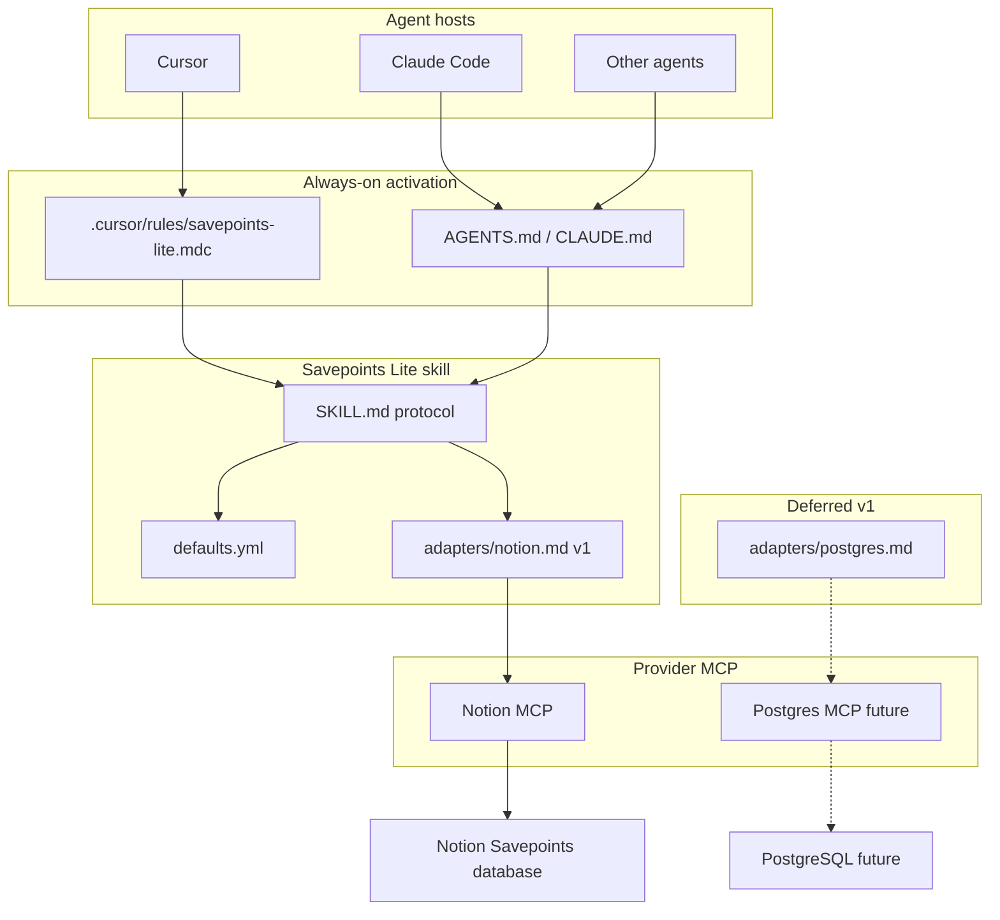

# Savepoints Lite v1 — implementation plan

## Goals and non-goals

**In scope:** Append-only session logging via **instruction-based storage adapters** (Notion MCP in v1), triggered by agent instructions (not lifecycle hooks), distributable as a **Cursor plugin** with canonical entry [`skills/savepoints/SKILL.md`](skills/savepoints/SKILL.md).

**Out of scope:** Everything listed in the product brief (read/recovery, queues, hooks, custom MCP server, local spool, summarization, metrics). **Also deferred for v1:** PostgreSQL (or other) adapter implementation, connection management, schema migrations, storage discovery, multi-provider writes.

**Contrast with [`multipliers-dev/savepoints`](https://github.com/multipliers-dev/savepoints):** Full Savepoints optimizes for *durable learnings* (five-check rubric, `emit-learning`, lifecycle hooks, Postgres submit workers). Lite optimizes for *activity/session narrative* with **immediate appends** and **no lifecycle/host automation** — but it **does** define an **instruction-based storage adapter** boundary so Notion today and Postgres (or another MCP-backed store) later do not require rewriting the core protocol.

---

## Architecture



| Layer | v1 responsibility |
| --- | --- |
| **Activation** | Triggers, “read skill + selected adapter,” fail-open |
| **`SKILL.md`** | Provider-neutral Savepoint model, event detection, `append` contract, failure/anti-loop rules |
| **`adapters/*.md`** | Provider-specific MCP tools, destination, mapping, write confirmation |
| **`defaults.yml`** | `storage.adapter` + `storage.destination` (and optional override path) |
| **Runtime** | None — agents follow instructions; no TypeScript adapter implementations |

**Design principle:** Protocol owns **semantics**; adapters own **persistence mechanics**. Activation layers stay **thin pointers** (same pattern as full Savepoints’ rule + `AGENTS.md`). Do **not** set `disable-model-invocation: true` on the skill.

**Caveat:** Adapters are **instructions**, not executable code — separation is **conceptual**, not type-enforced. **Behavioral** verification (manual sessions + checklists) is required to confirm agents resolve `defaults.yml` to the correct adapter doc and perform `append` through that provider.

| Component | Prior plan shape | This plan |
| --- | --- | --- |
| `SKILL.md` | Protocol + Notion write steps | Provider-neutral protocol only |
| `defaults.yml` | Notion destination ids | `storage.adapter` + `storage.destination` |
| `adapters/notion.md` | (embedded in skill) | Notion MCP mapping and confirmation |
| PostgreSQL | Not supported | Future `adapters/postgres.md` only |
| Runtime | None | None (unchanged) |
| v1 user-visible behavior | Notion appends | Unchanged |

---

## Savepoint protocol (provider-neutral)

Document in [`SKILL.md`](skills/savepoints/SKILL.md). Independent of Notion, Postgres, or any single MCP.

### Canonical Savepoint shape

Illustrative structure agents assemble before calling `append` (field names are protocol vocabulary, not a runtime schema):

```yaml
savepoint:
  title: "Implemented authentication"
  repository: "multipliers-dev/portfolio"
  agent: "Cursor Agent"
  session_id: null  # optional; omit when unknown

  content:
    what_was_done: "Added authentication middleware"
    decisions_made: "Selected JWT authentication"
    open_threads: "Token rotation"
    errors: null  # omit section when empty
```

### Metadata derivation (protocol)

| Field | Source |
| --- | --- |
| `title` | Short event label: `{repository} — {verb phrase}` |
| `repository` | `owner/repo` from `git remote get-url origin`, else workspace folder name |
| `agent` | Best available host label; never invent vendor names |
| `session_id` | Host-provided id only; do not fabricate |

### Content sections (protocol)

Map to persisted body under adapter formatting rules. Omit empty sections:

- `what_was_done`
- `decisions_made`
- `open_threads`
- `errors`

Each trigger produces **one new record** — no updates, dedupe, or batching.

### `append` contract (behavioral, not code)

Single conceptual operation the agent performs after assembling a Savepoint:

```text
append(savepoint) → success | failure | unconfirmed
```

The **selected adapter** must instruct the agent to:

- Create a **new** record without modifying previous records.
- Preserve Savepoint content and metadata per provider mapping.
- Confirm persistence when the provider supports it (`success`); otherwise report `unconfirmed` honestly.
- On `failure`, report in chat without blocking primary work (see failure behavior below).

**Per event, not per session:** Each trigger invokes `append` once. No session-wide latch after failure (Cloud may gain MCP mid-session). **No retry queue.**

---

## Storage adapters (instruction-based)

### Layout

```
skills/savepoints/
  SKILL.md                 # Protocol only — no provider-specific MCP steps
  defaults.yml             # storage.adapter + storage.destination
  adapters/
    notion.md              # v1 — Notion MCP append instructions
    postgres.md            # future — not shipped in v1
```

### Configuration

Bundled default ([`defaults.yml`](skills/savepoints/defaults.yml)):

```yaml
storage:
  adapter: notion
  destination: "822cbc89-7c89-4863-af3a-2fe0cd8ab56e"  # Notion data_source_id
```

Human reference for the shared database (not used as create parent when `destination` is set): database id `05e4c804-1380-4ea2-8eb6-30027aa05fe4`.

**Resolution order:**

1. [`skills/savepoints/defaults.yml`](skills/savepoints/defaults.yml) — canonical for default adopters.  
2. Optional workspace [`.agents/savepoints-lite.yml`](.agents/savepoints-lite.yml) in **consumer repos only** (override `storage.adapter` / `storage.destination`). Template documents shape; hub repo does not commit a live override file.

After resolving config, the agent **must read** [`adapters/<adapter>.md`](skills/savepoints/adapters/notion.md) before performing `append`. Unknown `storage.adapter` → report misconfiguration; do not guess a provider.

No env vars for v1. Auth remains with each provider’s MCP connection (Notion MCP for v1).

### [`adapters/notion.md`](skills/savepoints/adapters/notion.md) (v1)

Notion-specific only — keep out of `SKILL.md`:

| Topic | Contents |
| --- | --- |
| Destination | `parent.data_source_id` = resolved `storage.destination` |
| Property mapping | `title` → `Name`; `repository` → `Repository`; `agent` → `Agent`; `session_id` → `Session ID` (omit when unknown) |
| Body | Notion-flavored Markdown with `## What was done`, etc.; read markdown spec once when first composing |
| MCP tools | e.g. `notion-create-pages`; optional `notion-fetch` **only** on property mismatch or tool-required schema discovery — not a session preflight |
| Confirmation | `allow_async: false` by default; bounded async poll (at most **two** follow-ups); `success` / `failure` / `unconfirmed` per protocol |

Do **not** change the Notion database schema unless fetch proves incompatibility.

### Future: `adapters/postgres.md`

Placeholder in plan only. Would document Postgres MCP (or equivalent) insert/append steps. **Not implemented in v1** — no file required until a second provider is added; core `SKILL.md` should not need changes when it ships.

### Trigger contract (immediate writes)

The skill must require a Savepoint **in the same turn** when any of these occur:

- A coherent unit of work completes (feature slice, fix, doc pass, verification run).  
- A significant decision is made (architecture, scope, tradeoff).  
- The agent switches tasks or user changes direction.  
- An error is hit or resolved **in the primary task** (tooling, build, test, user-visible failure) — record under **Errors** in the Savepoint for that work event.

**Explicit anti-patterns:** session-end only, “remember to savepoint at the end,” debouncing, consolidating multiple events into one page.

### Failure behavior

On create error or unconfirmed async: one-sentence user-visible report (tool name + error summary, or “queued — not confirmed”), **no retry queue**, resume primary task. **Do not** disable subsequent Savepoint attempts in the same session.

**Anti-loop (failed Savepoint writes):** A **failed `append`** (provider MCP unavailable, auth error, create error, or unconfirmed async) is **not** an error event that triggers another Savepoint. Report the persistence failure in chat and continue the primary task. Do **not** chain “write failed → new Savepoint to log the failure → write failed again.” Only a **later, independent** work trigger may attempt another `append`.

---

## Skill structure

See **Storage adapters** above for the canonical tree. Summary:

| File | Role |
| --- | --- |
| [`SKILL.md`](skills/savepoints/SKILL.md) | Provider-neutral protocol |
| [`defaults.yml`](skills/savepoints/defaults.yml) | `storage.adapter` + `storage.destination` |
| [`adapters/notion.md`](skills/savepoints/adapters/notion.md) | Notion MCP `append` instructions (v1) |
| [`verification.md`](skills/savepoints/verification.md) | Manual + behavioral checklists — **adopt-and-verify only** |
| [`skills/README.md`](skills/README.md) | Index |

**[`SKILL.md`](skills/savepoints/SKILL.md) sections (suggested):**

1. Purpose and v1 boundaries  
2. When to write (trigger list)  
3. Savepoint shape + metadata derivation  
4. Config resolution → load matching `adapters/<adapter>.md`  
5. `append` contract and outcomes (`success` / `failure` / `unconfirmed`)  
6. Failure handling and anti-loop  
7. What **not** to do (read/update/batch/hooks; embedding Notion steps in `SKILL.md`)  
8. In **adopt-and-verify** only: link [`verification.md`](skills/savepoints/verification.md)

---

## Activation and distribution

### In-repo activation (this repository)

| File | Role |
| --- | --- |
| [`.cursor/rules/savepoints-lite.mdc`](.cursor/rules/savepoints-lite.mdc) | `alwaysApply: true` — short contract: triggers, “read skill before write,” fail-open |
| [`AGENTS.md`](AGENTS.md) | Savepoints Lite section: mandatory logging behavior, link to skill, Cloud reminder (no hooks) |
| [`CLAUDE.md`](CLAUDE.md) | `@AGENTS.md` or equivalent one-line import for Claude Code |

**Why always-on rule:** Cursor plugins distribute **skills**, not project rules ([editorial-workflow](https://github.com/multipliers-dev/editorial-workflow) / [renovate-workflow](https://github.com/multipliers-dev/renovate-workflow) ship `"skills": "./skills"` only). Continuous behavior requires a **committed** `alwaysApply` rule in each repo that should log (including this repo).

### Plugin / marketplace (distribution)

Follow renovate’s dual manifest pattern:

| File | Role |
| --- | --- |
| [`plugin.json`](plugin.json) | Agent Plugins 1.0 portable manifest (name, version, repo metadata) |
| [`.cursor-plugin/marketplace.json`](.cursor-plugin/marketplace.json) | Single-plugin marketplace for “Add from GitHub” |
| [`.cursor-plugin/plugin.json`](.cursor-plugin/plugin.json) | `"skills": "./skills"` |

**Consumer adoption** (new [`docs/adopt.md`](docs/adopt.md), modeled on [renovate-workflow/docs/adopt.md](https://github.com/multipliers-dev/renovate-workflow/blob/main/docs/adopt.md)):

1. Import `https://github.com/multipliers-dev/savepoints-lite` as marketplace; install **savepoints-lite** plugin.  
2. Copy [`templates/consumer/.cursor/rules/savepoints-lite.mdc`](templates/consumer/.cursor/rules/savepoints-lite.mdc) into the consumer repo (or merge equivalent prose).  
3. **Only if overriding the shared database:** copy template → `.agents/savepoints-lite.yml` in the consumer repo (not required for default adopters).  
4. Add a short pointer in consumer `AGENTS.md` / `CLAUDE.md`.  
5. Ensure the MCP for the configured adapter is connected (Notion MCP when `storage.adapter: notion`).

**Not in v1:** Listing inside `cursor-team-marketplace` (optional follow-up PR there).

### Claude Code portability

- **Same skill file** is canonical.  
- Adoption doc: install plugin if supported, else vendor `skills/savepoints/` into the project’s Claude skills path and replicate the always-on instruction via `CLAUDE.md` + `AGENTS.md`.  
- Verification item: one real task in Claude Code → confirm row in shared Notion DB.

---

## Bootstrap slimming (why change the template)

Current [`src/index.ts`](src/index.ts) is a placeholder (`console.log("ready")`). v1 has **no runtime**.

**Proposed changes:**

| Remove / change | Rationale |
| --- | --- |
| Remove `src/`, `tsx`, `typescript`, `dev`/`start` scripts | No executable product code |
| Replace with [`scripts/verify-protocol-files.sh`](scripts/verify-protocol-files.sh) | CI/pre-commit guard: `SKILL.md`, `defaults.yml`, `adapters/notion.md`, manifests parse; `storage.adapter: notion` and destination UUID present |
| [`package.json`](package.json) scripts: `test` + `typecheck` → both run verifier (keeps Husky/CI contract without a fake TS app) | Preserves team-harness hook story with minimal churn |
| Update [`README.md`](README.md) | Product description and Notion MCP prerequisite only — **no** link to `docs/adopt.md` until that file exists in adopt-and-verify |

**Keep unchanged unless required:** [`.cursor/hooks.json`](.cursor/hooks.json), [`.cursor/environment.json`](.cursor/environment.json), Husky prepare scripts — Lite explicitly does **not** add Savepoints hooks.

---

## Implementation slices (merge-safe)

Recommended **two implementation PRs** + docs closure. Each slice is **merge-safe on its own** — no cross-slice links to files that do not exist yet on `main`.

### Slice `protocol-core` (Open PR only)

**Deliverables:**

- `skills/savepoints/SKILL.md`, `skills/savepoints/defaults.yml`, `skills/savepoints/adapters/notion.md`, `skills/README.md` — **not** `verification.md` or `adapters/postgres.md` (slice 2 / future)  
- Override template only (e.g. `.agents/savepoints-lite.template.yml` or under `templates/consumer/`) — **no** committed `.agents/savepoints-lite.yml` in this repo  
- `.cursor/rules/savepoints-lite.mdc`  
- `AGENTS.md`, `CLAUDE.md`, [`README.md`](README.md) — product overview and Notion MCP prerequisite; **do not** link to [`docs/adopt.md`](docs/adopt.md) (file does not exist until slice 2)  
- `plugin.json`, `.cursor-plugin/*`  
- Bootstrap slim + `scripts/verify-protocol-files.sh`  

**Acceptance:**

- `npm test` and `npm run typecheck` pass (verifier only)  
- `verify-protocol-files.sh` checks protocol-core artifacts only (`SKILL.md`, `defaults.yml`, `adapters/notion.md`, plugin manifests, rule) — **must not** require `verification.md` or `docs/adopt.md`  
- Root `README.md` contains **no** reference to `docs/adopt.md` (grep / verifier assertion acceptable)  
- No new hooks beyond existing git-hook stack  

### Slice `adopt-and-verify` (Open PR only)

**Deliverables:**

- [`docs/adopt.md`](docs/adopt.md) **created in this slice** (first appearance in repo)  
- **Same PR:** update root [`README.md`](README.md) to add an adoption section linking to [`docs/adopt.md`](docs/adopt.md) (relative path, e.g. `[docs/adopt.md](docs/adopt.md)`) — link lands in the **same commit** as the adopt doc so the slice stays merge-safe  
- [`templates/consumer/`](templates/consumer/) (rule snippet + optional AGENTS.md fragment)  
- [`skills/savepoints/verification.md`](skills/savepoints/verification.md) **created here** with checklists; update `SKILL.md` to link it  

**Acceptance:**

- Adopt doc describes Cursor + Claude paths  
- `README.md` links to `docs/adopt.md` and the target file exists in this PR  
- Manual verification section clearly labeled  
- Extend `verify-protocol-files.sh` to require `verification.md` and `docs/adopt.md` in this slice (optional tightening)  

### `plan-closure` (docs-only, after slices merge)

- `# Shipped` note, archive plan under `.cursor/plans/archive/`, mark `plan-closure` completed.

---

## Verification

### Automatable (CI / local)

| Check | Mechanism |
| --- | --- |
| Skill + plugin artifacts exist | `scripts/verify-protocol-files.sh` (protocol-core scope; add `verification.md` in adopt-and-verify) |
| JSON manifests parse | same script (`node -e` or `python -m json.tool`) |
| `storage.adapter: notion` and destination UUID unchanged | grep/assert in `defaults.yml` |
| No accidental hook additions | script asserts `.cursor/hooks.json` has no savepoints-specific hooks |

**Do not** build an “agent compliance test framework.”

### Manual (real agent sessions — required for behavioral claims)

Use [`skills/savepoints/verification.md`](skills/savepoints/verification.md):

| # | Scenario | Pass criteria |
| --- | --- | --- |
| 1 | **Discoverability** | Fresh Cursor chat in `savepoints-lite`; agent loads rule/skill without user saying “use savepoints” |
| 2 | **Implicit logging** | Complete a small doc edit; **≥1** Notion row appears without user reminder |
| 3 | **Metadata** | Row has correct `Repository`, `Agent`, sensible `Name`; `Session ID` only if host provided |
| 4 | **Content** | Body includes appropriate sections; empty sections omitted |
| 5 | **Multi-write** | Same session: decision + completed task → **≥2** rows |
| 6 | **Fail-open per event** | With MCP unavailable, agent finishes task and reports write failure; after MCP is available again in the **same session**, a later trigger still produces a row |
| 6b | **Persistence honesty** | Agent does not claim “saved to Notion” unless sync create succeeded or bounded async poll reached `succeeded` |
| 6c | **No Savepoint-on-failure loop** | After a failed Savepoint write, agent reports in chat only; does not immediately open another Savepoint solely to record that failure |
| 7 | **Claude Code** | Repeat 2–5 in Claude with same DB |
| 8 | **No hooks** | Confirm logging still works with only instructions (no new lifecycle hooks) |
| 9 | **Adapter selection** | With default `defaults.yml`, agent follows `adapters/notion.md` (Notion MCP tools), not inline Postgres or ad-hoc API steps |

Record manual run date + Notion page URLs in PR description or verification checklist (not committed secrets).

---

## Compatibility limits and open decisions

| Topic | Limitation / decision |
| --- | --- |
| **Enforcement** | Instructions + `alwaysApply` rule are **best-effort**; models can still skip writes — v1 accepts this by design (no hooks). |
| **Plugin vs rule** | Installing the plugin alone does **not** enable continuous logging; consumers must add the rule (document loudly in `docs/adopt.md`). |
| **Cloud Agents** | Rely on `AGENTS.md` (+ optional future `.cursor/CLOUD.md` one-pager); rules may load but must not assume hook delivery. |
| **Session ID** | Inconsistent across hosts; optional by design. |
| **Instruction adapters** | Boundary is behavioral; agents may drift — verify via manual checklist (row 9) and adopt doc emphasis on reading `adapters/<adapter>.md`. |
| **Notion MCP variance** | Document in `adapters/notion.md`; tool names may differ by client — use connected Notion MCP create-page tool and documented property names unless a create error forces fetch. |
| **PostgreSQL / multi-provider** | Deferred — no `adapters/postgres.md`, migrations, or dual-write in v1. |
| **Async creates** | Prefer `allow_async: false`; when async is unavoidable, **bounded** poll (no indefinite wait); then success, terminal failure, or unconfirmed — never imply persistence on queue alone. |
| **Skill name** | **Decision:** use `savepoints` (slash `/savepoints`) vs `savepoints-lite` — recommend **`savepoints`** for ergonomics with repo name `savepoints-lite` disambiguating the product. |
| **cursor-team-marketplace** | **Deferred:** optional third PR to add marketplace entry after v1 proven. |

---

## Recommended execution authority

| Slice | Recommended authority | Agent instruction |
| --- | --- | --- |
| Plan review (this PR) | Plan-only PR | Do not begin implementation slices. Stop after opening the PR. |
| `protocol-core` | Open PR only | Do not merge. Stop after opening the PR. |
| `adopt-and-verify` | Open PR only | Do not merge. Stop after opening the PR. |
| `plan-closure` | Open PR only | Do not merge. Stop after opening the PR. |

---

## Agent prompts (copy/paste for Cursor)

### protocol-core

```text
@.cursor/plans/2026-10-27-savepoints-lite-v1.plan.md

Implement slice protocol-core only. Do not start adopt-and-verify or plan-closure.

Authority: Open PR only — implement and open the PR; do not merge.

Topology: start from latest origin/main; branch represents only this slice; PR base must be main.

Deliverables: per plan — provider-neutral SKILL.md, defaults.yml (storage.adapter/destination), adapters/notion.md, override template, alwaysApply rule, AGENTS.md/CLAUDE.md, plugin manifests, bootstrap slim, verify-protocol-files.sh, README without any docs/adopt.md link. Mark protocol-core completed in plan frontmatter in this PR.

Verification: npm test && npm run typecheck. Do not create Notion test rows unless explicitly asked.
```

### adopt-and-verify

```text
@.cursor/plans/2026-10-27-savepoints-lite-v1.plan.md

Implement slice adopt-and-verify only. Prerequisite: protocol-core merged. Do not archive the plan.

Authority: Open PR only — implement and open the PR; do not merge.

Topology: start from latest origin/main; branch represents only this slice; PR base must be main.

Deliverables: docs/adopt.md (new), README.md adoption link to docs/adopt.md in the same PR, templates/consumer/, skills/savepoints/verification.md. Mark adopt-and-verify completed in plan frontmatter in this PR.

Verification: npm test && npm run typecheck; manual checklist documented (no required Notion writes in CI).
```

### plan-closure

```text
@.cursor/plans/2026-10-27-savepoints-lite-v1.plan.md

Execute only plan-closure.

Authority: Open PR only — docs-only archive PR; do not merge.

Prerequisites: protocol-core and adopt-and-verify merged to main.

Deliverables: # Shipped note, move plan to .cursor/plans/archive/, mark plan-closure completed.

Verification: confirm prerequisite PRs merged.
```
