# Post-write verification hardening (Savepoints Lite 2.2.0)

## Architectural principle: deterministic capabilities, flexible orchestration

Savepoints Lite provides the capabilities; consumers own the orchestration. Applies to **Savepoints Lite as a whole**, not only post-write verification. It is an authority boundary between what the package provides and what the consumer decides.

| Capability (provided by the package) | Orchestration (owned by the consumer) |
| --- | --- |
| **Invocation:** Savepoint creation and persistence (router, Notion provider, schema, mapping) | Agent discretion, vendor-specific hooks, custom automation, manual invocation: flexible, replaceable, optional |
| **Verification:** persisted-data validation (CLI) and bounded repair | The same: when, how often, and whether to verify, including any hook or automation that guarantees it |

Hooks are not undesirable; they simply do not belong in the core package. Adopters who need stronger guarantees build their own orchestration on the same capabilities without reimplementing them.

Canonical wording (documented once, in README.md):

> **Deterministic capabilities, flexible orchestration**
>
> Savepoints Lite separates invocation and verification into independently usable capabilities. The orchestration between them is intentionally left to the consumer.
>
> Agents can invoke verification at their discretion, while adopters requiring stronger guarantees can integrate their own hooks, automation or host-specific lifecycle mechanisms.
>
> Savepoints Lite is responsible for making its capabilities discoverable, intuitive, reliable and portable. It is not responsible for enforcing when or how frequently those capabilities are invoked.
>
> This separation allows consumers to choose their own reliability, execution and cost trade-offs without introducing vendor-specific dependencies into the core implementation.

Implications:

- `validation.post_write: true` means "verification tooling and guidance are available", not "verification is required". Verification is best-effort, never a completion condition for any append.
- Success is measured by record quality and by whether verification works first time **when an agent chooses to use it**, not by how often agents choose to use it. Skipping verification is not inherently a failure; incorrectly performing it is a tooling or instruction usability concern. Do not steer toward bundled enforcement.
- **Composability:** do not make external orchestration harder. Capabilities stay independently usable and portable: the CLI is standalone (no Notion calls, no host coupling), its input shapes, JSON output, and exit codes are a stable documented contract (2.2.0 changes are additive), and capabilities do not depend on one entry path. This makes bundled hooks unnecessary and external ones easy.
- Scope note: the principle limits what the **package** enforces. It does not weaken the session-logging contract an operator opts into through their own activation (User Rules or root `AGENTS.md`); that remains the operator's orchestration, outside the package.

### Documentation placement (reviewed against existing structure)

Existing structure: `README.md` and `docs/architecture.md` ship in the npm tarball; `AGENTS.md` is repo-only; the marketplace vendors only `skills/` (no README), so skills cannot link to README. `docs/architecture.md` already has a one-line "Design principle" (router/provider/validator ownership) and distribution invariants (including "Optional execution / fail open" and a table row stating bundling does not guarantee invocation). One canonical explanation, concise references elsewhere. **Transition rule:** the principle statement (README, `AGENTS.md`, one architecture reference) lands first in `principle-docs`; everything that changes documented configuration or verification semantics lands in `cli-and-skill-hardening` together with the skills, so public docs never describe behaviour the skills do not yet guide. `principle-docs` and `cli-and-skill-hardening` both merge before any 2.2.0 publish.

| File | Slice | Role | Content |
| --- | --- | --- | --- |
| `README.md` | principle-docs | **Canonical, public-facing** | New short "Design principle" section after "How it works" with the wording above (no further rationale) |
| `AGENTS.md` | principle-docs | Maintainer constraint | New "Architectural constraints" section: link to README principle; do not bundle vendor-specific orchestration or enforcement (hooks, lifecycle integrations, mandatory execution) in the core package, and equally do not make external orchestration harder (keep the CLI contract stable and standalone, no host coupling); do not treat low invocation as a defect; classify outcomes (skipped = acceptable, incorrectly performed = tooling or instruction usability bug); apply this when reviewing audit metrics; scope note above. Must keep existing `AGENTS.md` invariants tests passing |
| `docs/architecture.md` | principle-docs | Reference only | One sentence plus README link appended to the existing "Design principle" line; no restated rationale. Existing invariant 4 and the validator-table "Invocation" row already match the principle and stay unchanged |
| `docs/adopt.md` (Optional post-write validation), `templates/consumer/savepoints-lite.yml.example` comment | cli-and-skill-hardening | Configuration docs | Describe `validation.post_write` as enabling tooling that the agent may use; replace "runs" phrasing; one line that the structured JSON input, JSON output, and exit codes are the integration surface for adopters orchestrating verification with their own hooks or automation (the Notion fetch parser is an agent convenience, not the contract); no rationale |
| `skills/savepoints/SKILL.md`, `skills/savepoints-notion/SKILL.md` | cli-and-skill-hardening | Instructions | Self-contained capability wording only (decision 7); no link to README, no rationale paragraph |
| `skills/savepoints/verification.md`, `docs/adoption-verification-record.md` | cli-and-skill-hardening (record updated again in hub-dogfood-pin) | Verification docs | One sentence: rows 14-20 assess tool correctness and usability, not invocation frequency; new scenario 20 |
| Marketplace `plugins/team-harness/docs/savepoints-integration.md` | marketplace-adopt | Downstream | One-line reference; leave `docs/engineering-invariants.md` unchanged to avoid forcing a User Rules re-paste |

No new tests for principle prose (see Test policy below); the principle is reviewed by humans, not asserted by string matching.

## Context and evidence base

Source: the completed one-week v2.1.0 effectiveness audit (20-27 Nov 2026). This plan does not repeat it.

| Observation (n=39 post-adoption records) | Value |
| --- | --- |
| Required property completeness | 100% (baseline before v2.1.0: 103/119, 86.55%) |
| Organic repairs | 0 |
| Verification attempts (denominator for correctness) | 18/39 |
| Correct: read-back plus CLI validation | 11/18 (61.1%) |
| Synthetic: CLI run on self-built JSON, no read-back | 6/18 (33.3%) |
| Invalid invocation (unsupported flag, failure suppressed) | 1/18 (5.6%) |
| Verification not attempted (context only; agent discretion, not a defect, outside the correctness denominator) | 21/39 (53.8%) |
| Validator-invoking sessions failing first CLI call | 5/9 (first-attempt success 44.4%) |
| Bare repository name (not `owner/repo`) | 5/39 (format compliance 34/39, 87.2%) |
| Titles missing `{owner/repo} — ` prefix | 22/39 |

### Reference baseline for optional future audits

Effectiveness audits are not a slice, release dependency, or plan-closure dependency. The operator may run one independently during normal dogfooding, at their discretion, using the same method as the v2.1.0 audit (paginate the whole Notion Savepoints database, compare `page_last_edited_at` to `Created`, inspect session transcripts). No thresholds act as gates; report attempt counts with every percentage and distinguish observed, inferred, and unverified.

**Two denominators, kept separate.** Record-quality metrics use **all records** in the cohort. Verification-correctness metrics use **verification attempts** only (a record counts as an attempt when the agent ran the validator CLI or a post-create `notion-fetch` read-back for it). Records where verification was not attempted are contextual evidence and never enter the correctness denominator.

*Record quality (denominator: all cohort records):*

| Metric | v2.1.0 baseline | Role in a future audit |
| --- | --- | --- |
| Required property completeness | 100% (39/39) | **Primary** |
| Repository format compliance (`owner/repo`) | 87.2% (34/39) | **Primary** |
| Title prefix conformance | 43.6% (17/39) | Secondary |
| Organic repairs | 0 | Observational |

*Verification correctness (denominator: verification attempts; baseline 18 attempts):*

| Metric | v2.1.0 baseline | Role in a future audit |
| --- | --- | --- |
| Correct verification (persisted-data read-back plus successful CLI validation) | 61.1% (11/18) | Diagnostic (expected to rise) |
| Synthetic input (CLI on self-built JSON, no read-back) | 33.3% (6/18) | Diagnostic (expected to fall) |
| Invalid invocation (unsupported flag, suppressed failure) | 5.6% (1/18) | Diagnostic (expected to fall) |
| First-attempt CLI success (denominator: CLI-invoking sessions) | 44.4% (4/9) | Diagnostic (discoverability; expected to rise) |

*Context only (not a correctness input, not a defect):* verification not attempted 53.8% (21/39); attempt rate 46.2% (18/39); usage by append position within a session.

Root causes observed in transcripts (observed, not inferred):

- Provider `SKILL.md` post-write section sits at lines 73-99 of 117; one agent read only the first 80 lines and invented `--page-id ... || true`.
- `src/validate/cli.ts` exits 2 unless `--stdin` or `--input` is given; the skill says "stdin or `--input`" with no command example (5/9 first-call failures).
- Agents rebuild JSON by hand from intended values; only 2 rows parsed the fetched `<properties>` block.
- Guidance is ambiguous on whether verification is per-append or one-off, and reads as a ritual rather than an optional capability; when verification was used it was often done incorrectly or hit tool friction (7 of 18 attempts: 6 on self-built JSON, 1 invalid invocation). The fix is clearer, easier tools, not a stronger mandate.
- `schema.md` lists "workspace folder name" as a repository fallback in the same line as the git remote.

Original failure mode (missing Agent/Repository) has not recurred, so changes stay small and instruction-led. Non-goals are listed at the end.

## Resolved technical decisions

1. **Implicit stdin:** when neither `--stdin` nor `--input` is given and stdin is not a TTY, read stdin. TTY with no args still exits 2 with usage. Empty stdin, or no byte or EOF within 3 seconds (agent shell with an open idle pipe), exits 2 with "no input". `--stdin`, `--input`, `--package-root`, and "only one of" behavior are unchanged. Exit codes unchanged: 0 ok, 1 issues, 2 usage/runtime/invalid input.
2. **Persisted-data handoff (input adapter, not a validator change):** the structured `{ "persisted": ..., "page_id": ... }` JSON remains the **canonical integration contract**, including for consumers building their own orchestration. As a convenience for agents only, the CLI gains a Notion-specific **input adapter** in its own module, `src/validate/notion-fetch-input.ts` (the single canonical name used throughout this plan), that recognizes a `notion-fetch` result (JSON envelope whose string `text` contains a `<properties>...</properties>` block, or raw text containing that block), extracts the tag contents, and `JSON.parse`s them. **Normalization boundary:** every raw payload from stdin or `--input`, structured JSON and Notion fetch formats alike, passes through one normalization step in the CLI (e.g. `normalizeCliInput(raw)`) that returns the canonical `{ persisted, page_id? }` input, and only that output is handed to `validatePersistedProperties`. Normalization classifies the payload after parsing, not before: a JSON object that already has `persisted` passes through unchanged; a JSON object that is a fetch envelope (string `text` with a `<properties>` block) is routed to the adapter; non-JSON text containing the block is routed to the adapter; anything else is `invalid_input`. Parse-then-validate without this step would let an envelope parse as JSON and reach the validator unnormalized. `validatePersistedProperties` and the schema/mapping contracts are unchanged in responsibility and never see raw fetch text; the adapter has no knowledge of requiredness or repair. Missing or unparsable block is `invalid_input` (exit 2, treated as verification unavailable). Docs describe the adapter as an agent convenience and the structured JSON as the integration surface. No new tool calls: the agent already runs `notion-fetch`.
3. **Repository check:** advisory only. A non-empty `Repository` not matching `^[^\s/]+/[^\s/]+$` adds `warnings: [{ kind: "repository_format", ... }]`. `ok`, `issues`, and exit code are unchanged; `warnings` is omitted when empty. Rationale: `schema.md` legitimately allows a folder-name fallback when no `origin` exists, so a failing issue would create false positives and tempt guessed repairs. Provider rule: never repair on a warning; report once.
4. **Titles:** instruction-only; no validator change.
5. **Version:** `2.2.0` (additive CLI input shapes and optional output field; defaults and `validation.post_write: false` unchanged).
6. **Instruction budget (review aid, not a test):** aim for a net reduction in the two `SKILL.md` files (today 146 + 117 lines) with the verification how-to near the top of the provider skill. Report before/after line counts in the PR description for reviewers. No permanent test asserts line counts, headings, or exact phrases, because that would invite compressing instructions into longer, less readable lines to satisfy the test.
7. **Optional-use wording (guiding principle):** the provider skill says that when `validation.post_write` is true the agent **may** verify a given append, deciding each append independently (no session-level latch, no "first append only" reading), and that skipping is acceptable. Replace the current mandatory phrasing ("Complete these steps before returning to the router") with capability phrasing. One short line of when verification tends to be worthwhile (complex or first write to a repo, schema recently discovered, an earlier append in the session had a gap, operator asked) as a hint, not a rule. Fail-open outcomes (`success | failure | unconfirmed`, `verification unavailable`, `repair confirmation unknown`) are unchanged. Discoverability: the canonical command sits at the top of the provider skill and in `--help` output.

## Material decisions for operator confirmation

- **D1 (recommended: yes):** CLI accepts the Notion `<properties>` block through an isolated input adapter (`src/validate/notion-fetch-input.ts`) behind a single normalization boundary that all input passes through, producing the canonical structured JSON; the core validator and the structured contract are untouched, and the adapter fails closed to "verification unavailable". Alternative: instruction-only heredoc of a `{persisted}` object (no CLI parsing, keeps hand-built JSON).
- **D2 (recommended: advisory `warnings`):** alternative is a failing `invalid_repository_format` issue (exit 1), which risks false positives for no-remote workspaces.
- **D3 (recommended: minor 2.2.0 / team-harness 1.17.0):** confirm versioning.
- **D5 (recommended: yes):** principle placement. README is the single canonical statement (public-facing, shipped in the tarball); `AGENTS.md` carries maintainer constraints; `docs/architecture.md` and configuration/verification docs only reference it; skills stay self-contained (the marketplace vendors `skills/` only). The principle statement ships as its own docs-only slice (`principle-docs`) ahead of the code slice; configuration and verification semantics change together with the skills in `cli-and-skill-hardening`, never earlier. Alternative: make `docs/architecture.md` canonical with README as a summary.
- **D4 (recommended: yes):** reword the 2.1.0 provider text from "complete these steps before returning" to optional, agent-judged capability wording (guiding principle). Behavior of existing consumers is unaffected (outcomes and fail-open unchanged; default remains off), but the documented contract of `validation.post_write: true` softens from "run" to "available".

## Recommended execution authority

| Slice | Recommended authority | Agent instruction |
| --- | --- | --- |
| plan-review | Plan-only PR | Do not implement. Stop after opening the plan-only PR. |
| principle-docs | Open PR only | Do not merge. Stop after opening the PR. Docs only; do not publish to npm. |
| cli-and-skill-hardening | Open PR only | Do not merge. Stop after opening the PR. Do not publish to npm. |
| marketplace-adopt | Open PR only | Do not merge. Stop after opening the PR. Do not edit the plan from the marketplace repo. |
| smoke-verification | Manual verification gate | Do not commit or open a PR. Run only the specified verification; report the verdict; stop. |
| hub-dogfood-pin | Open PR only | Do not merge. Stop after opening the PR. |
| plan-closure | Open PR only | Do not merge. Stop after opening the PR. |

Repo default: **Open PR only**. No slice grants Merge granted. Operator-only steps (not agent actions): npm publish, plugin refresh, User Rules paste.

## Repository topology

Multi-slice plans stack execution order, not Git branches. Integration branch is `main` in both repos. Each PR starts from latest `origin/main` of its repo, represents only its slice, and targets `main`. Plan authority lives in `multipliers-dev/savepoints-lite`; `marketplace-adopt` is cross-repo, so its completion is recorded in `hub-dogfood-pin` (plan-status), not by editing the plan from the marketplace repo.

## Rollout sequence

```mermaid
flowchart LR
  planPR["plan-review"] --> principle["principle-docs PR"]
  principle --> impl["cli-and-skill-hardening PR"]
  impl --> publish["Operator: publish 2.2.0 via workflow_dispatch"]
  publish --> market["marketplace-adopt PR"]
  market --> refresh["Operator: refresh plugin to 1.17.0, fresh chats"]
  refresh --> smoke["smoke-verification gate"]
  smoke --> pin["hub-dogfood-pin PR"]
  pin --> closure["plan-closure"]
```



---

## Slice — plan-review

**Recommended authority:** Plan-only PR

**Rationale:** Plan artifact only; operator approves scope and D1-D5 before implementation.

**Agent instruction:** Do not implement. Stop after opening the plan-only PR.

**Goal:** Commit this plan as `.cursor/plans/2026-11-27-post-write-verification-hardening.plan.md` in `multipliers-dev/savepoints-lite` (run `npm run validate:plans`).

**Acceptance:** Validator passes; diff is the plan file only; PR base is `main`.

---

## Slice — principle-docs

**Recommended authority:** Open PR only

**Rationale:** Project-wide principle, independent of the CLI change; reviewable and merge-safe alone, and lets later slices and future reviewers reference it.

**Agent instruction:** Do not merge. Stop after opening the PR. Docs only; do not publish to npm.

**Goal:** Apply only the `principle-docs` rows of the "Documentation placement" table in `savepoints-lite`: README canonical section, `AGENTS.md` constraints, one-sentence reference in `docs/architecture.md`. Do not change configuration or verification semantics anywhere (`docs/adopt.md`, the config template, `verification.md`, skills; those land in `cli-and-skill-hardening`), do not touch the two `SKILL.md` files, and do not bump the version. No release between this PR and `cli-and-skill-hardening`.

**Acceptance:** one canonical explanation (README) with a single reference in `docs/architecture.md`, no duplicated rationale; `AGENTS.md` existing invariants still pass (no per-repo activation, `team-harness`, distribution section, marketplace link); README keeps version and link assertions; no new prose-matching tests; tarball contents unchanged (`expected-package-paths.txt`); `npm ci`, `npm test`, `npm run verify`, `npm run validate:plans` pass; frontmatter `principle-docs` marked completed in this PR.

---

## Slice — cli-and-skill-hardening

**Recommended authority:** Open PR only

**Rationale:** One coherent concern (verification ergonomics); instructions reference CLI behavior, so code, tests, and skill text must ship together to be merge-safe.

**Agent instruction:** Do not merge. Stop after opening the PR. Do not publish to npm.

**Prerequisite:** `principle-docs` merged.

**Goal:** Implement decisions 1-7 in `savepoints-lite`, consistent with the principle documented in README (capability wording in the skills, no rationale duplication).

### Implementation steps (dependency order)

1. **CLI input** (`src/validate/cli.ts`; new module `src/validate/notion-fetch-input.ts`):
   - Implicit stdin and idle guard per decision 1; update `printHelp()` and the file header.
   - **Normalize before validate (required):** `cli.ts` reads raw text from stdin or `--input`, then calls one normalization function (e.g. `normalizeCliInput(raw)`) on every payload, structured JSON and Notion fetch formats alike; its output is the canonical `{ persisted, page_id? }` input, and `validatePersistedProperties` is called only with that output. Classification happens after `JSON.parse`: object with `persisted` passes through unchanged; fetch envelope or raw text with a `<properties>` block goes to the adapter; anything else is `invalid_input` (exit 2). `cli.ts` must not call `validatePersistedProperties` on a parsed-but-unnormalized object.
   - `<properties>` extraction per decision 2 lives only in `src/validate/notion-fetch-input.ts`, which only normalizes fetch formats to the canonical shape; `validate.ts` is not modified for it, the structured `{persisted}` contract stays primary and documented, and exit-code semantics are unchanged (0 ok, 1 issues, 2 usage/runtime/invalid input). The esbuild bundle entry is `cli.ts`, so the new module is included on `npm run build`; confirm the committed `skills/bin/savepoints-lite-validate.mjs` contains it.
   - Unknown flag error should list accepted flags (helps the `--page-id` failure class).
2. **Validator** (`src/validate/validate.ts`, `types.ts`): add `warnings` and the repository format check per decision 3. Schema requiredness stays in `schema.json`; the repository pattern is a code constant documented in `schema.md`. Repair semantics untouched.
3. **Rebuild** committed bundle: `npm run build` updates `skills/bin/savepoints-lite-validate.mjs`.
4. **Provider skill** (`skills/savepoints-notion/SKILL.md`), rewrite by replacing, not appending:
   - Move a compact **Verification how-to** (when `validation.post_write` is true and you judge it worthwhile for this append: `notion-fetch`, validate, repair once if warranted, report) to the top, before configuration tiers. Condense the destination tier prose; existing `package-invariants` assertions that the rewrite touches are updated minimally to the new wording, not extended.
   - Post-write section states (capability wording, decision 7): verification is optional and judged per append, with no session-level latch; if you validate, use the **persisted** properties from the `notion-fetch` result, **never** the values you just sent to create; exit 2 or missing Node means **verification unavailable**, report it briefly, do not append `|| true`, do not repair. Skipping verification is acceptable and does not change the append outcome.
   - One canonical command (CLI path is `../bin/savepoints-lite-validate.mjs` relative to this file; use the install root, not the consumer repo):
     ```bash
     node <install-root>/skills/bin/savepoints-lite-validate.mjs <<'EOF'
     <properties>
     {...paste the properties block from the notion-fetch result...}
     </properties>
     EOF
     ```
     plus the note that a saved fetch result can be piped with `< file`, and `--input '<json>'` / `--stdin` remain valid.
   - Repair: only `missing_persisted_property` from values already on the Savepoint; a `repository_format` warning is reported, never repaired.
5. **Router skill** (`skills/savepoints/SKILL.md`): remove duplicated install-root and integration-handoff prose (the two install-root tables overlap); add one line that, when enabled, verification is available for each append and is the agent's call. Preserve the tier-1/2/3 precedence text asserted by tests.
6. **Metadata clarity** (`skills/savepoints/schema.md`, router "Build the Savepoint"): repository = `owner/repo` parsed from `git remote get-url origin` in the checkout where the work happened; folder name only when no `origin` exists; never a bare folder name when a remote exists. Title = `owner/repo — short verb phrase`, one example, plain text with no Markdown escapes. Remove the redundant derivation restatements.
7. **Tests:**
   - `test/validate.test.js`: implicit stdin valid (0), missing property (1), invalid JSON (2), empty stdin (2), idle open pipe (2 within about 3s); explicit `--stdin` and `--input` unchanged; `--stdin` plus `--input` (2); unknown flag (2); `notion-fetch` envelope via stdin (0) using a new fixture mirroring the real `{text: "...<properties>...</properties>..."}` shape; raw properties block (0); envelope with no or broken block (2); repository `owner/repo` (no warnings key), bare `resumes` (ok true, exit 0, one `repository_format` warning), compound `a/b; c/d` (warning), empty repository (still `missing_persisted_property`, no warning); simulated vendor-tree test switched to implicit stdin.
   - Adapter and normalization unit tests (for `notion-fetch-input.ts` and `normalizeCliInput`) are separate from validator-core tests: structured `{persisted}` input passes through unchanged; envelope and raw `<properties>` block normalize to the canonical shape; a JSON object that is neither structured nor an envelope, and missing/broken blocks, are `invalid_input`. A CLI-level test proves an envelope on stdin reaches validation only via normalization (exit 0), not as parsed-but-unnormalized JSON. Core validator tests continue to use structured input only.
   - **Test policy:** behavioral tests (CLI invocation patterns, exit codes, JSON output, adapter normalization, repository warning, tier resolution) and existing structural contracts (referenced files and CLI path exist, tarball contents). **No new tests** for exact prose, headings, phrase presence, or line counts in skills or docs. `test/package-invariants.test.js` only gets the minimal edits needed for existing assertions that the rewrite touches. Instruction quality (optional wording, no mandatory phrasing, verification how-to near the top, persisted-versus-intended, before/after line counts) is a review checklist item in the PR description, checked by humans and Bugbot.
8. **Docs and release prep:** `package.json` and lockfile to `2.2.0`; README version string, `docs/architecture.md` (validator row), `skills/README.md`; **configuration and verification semantics change here with the skills** (not earlier): `docs/adopt.md` Optional post-write validation and `templates/consumer/savepoints-lite.yml.example` describe `validation.post_write` as enabling tooling the agent may use, plus the integration-surface line (structured JSON input, JSON output, exit codes; the Notion fetch parser is an agent convenience); `skills/savepoints/verification.md` one-sentence note that rows 14-20 assess tool correctness and usability, not invocation frequency, plus new scenario **20 (verification tooling smoke, successive appends)**; do not restate the principle rationale (keep skills self-contained); no new packaged files (so `expected-package-paths.txt` is unchanged).
9. **Empirical check during implementation:** run the bare CLI from a Cursor agent Shell tool with no pipe and confirm it exits 2 within the guard window rather than hanging; record the result in the PR description.

**Acceptance:** piped JSON, a `notion-fetch` result, `--stdin`, and `--input` all work; exit codes unchanged; `warnings` omitted when empty; fail-open and bounded-repair text preserved; all CLI input (structured JSON and Notion fetch formats) passes through the normalization boundary before `validatePersistedProperties`; Notion fetch parsing isolated in `src/validate/notion-fetch-input.ts` with `validate.ts` untouched by it and structured JSON remaining the canonical contract; config and verification docs consistent with the new skill wording in the same PR; `npm ci`, `npm test`, `npm run verify`, `npm run validate:plans` pass; PR description lists D1-D5 outcomes, the Shell-hang check, and a review checklist with before/after skill line counts (aim: net reduction; not enforced by a test), optional-use wording with no mandatory phrasing, and the verification how-to near the top of the provider skill; frontmatter `cli-and-skill-hardening` marked completed in this PR.

**Release (operator, after merge):** run **Publish savepoints-lite (manual)** with `confirm_version: 2.2.0` per `docs/publishing.md` (preflight 404, provenance); verify `npm view @multipliers-dev/savepoints-lite@2.2.0 version`, `dist-tags`, and a clean `npm install` outside any repo.

---

## Slice — marketplace-adopt

**Recommended authority:** Open PR only

**Rationale:** Cross-repo distribution slice; marketplace pins and byte-syncs the published package, no savepoints-lite edits. Mirrors the 2.1.0 adoption (PR #78).

**Agent instruction:** Do not merge. Stop after opening the PR. Do not edit the plan file.

**Required repositories:**
- multipliers-dev/cursor-team-marketplace: implementation target, read/write
- multipliers-dev/savepoints-lite: plan authority, read-only

**Prerequisite:** `@multipliers-dev/savepoints-lite@2.2.0` visible on npm.

**Goal and steps:** pin `2.2.0` + lockfile; `npm run sync:savepoints-vendor` and commit `plugins/team-harness/vendor/savepoints-lite/` (`PACKAGE_VERSION=2.2.0`); `npm run verify:savepoints-vendor`; extend `scripts/verify-savepoints-vendor-cli.test.ts` for implicit stdin and a `notion-fetch` envelope against the vendored tree; layout script still green; grep wrapper (`plugins/team-harness/skills/savepoints/SKILL.md`) and docs for `--stdin` guidance and update only if present (wrapper stays thin); `plugins/team-harness/docs/savepoints-integration.md` (include a one-line reference to the Savepoints Lite principle, "deterministic capabilities, flexible orchestration", not a restatement) and `docs/versioning.md`; version bump to team-harness **1.17.0** across `plugin.json`, `.cursor-plugin/plugin.json`, `.cursor-plugin/marketplace.json`. Engineering invariants and User Rules template: no change expected (flag already opt-in); if `docs/engineering-invariants.md` changes, regenerate the local paste and note the re-paste.

**Acceptance:** vendor byte-matches npm; post-sync router still documents tier-1 `validation.post_write`; `npm ci`, `npm run verify:savepoints-vendor`, `sh scripts/verify-savepoints-marketplace-layout.sh`, `npm test`, `npm run typecheck`, `npm run validate:plans`, `sh scripts/check.sh` pass. Completion recorded via `hub-dogfood-pin`.

**Operator adoption (after merge):** refresh the team-harness plugin to 1.17.0; confirm cache `PACKAGE_VERSION` is `2.2.0`; confirm User Rules still contain `validation: { post_write: true }` (re-paste only if invariants changed); start **fresh** chats (running sessions keep old skill text).

---

## Slice — smoke-verification

**Recommended authority:** Manual verification gate

**Rationale:** Agent behavior is instruction-driven; CI cannot prove it. Automated tests prove only CLI and layout.

**Agent instruction:** Do not commit or open a PR. Run only the specified verification; report the verdict; stop.

**Specified verification** (operator-authorized live Notion MCP, installed plugin 1.17.0, a non-hub repo with a real `origin`, `validation.post_write: true`):

| # | Scenario | Observe |
| --- | --- | --- |
| 1 | Three or more successive appends in one session (distinct small work events); operator explicitly asks the agent to verify at least the first and the last | When verification is performed: `notion-fetch`, documented command (no `--stdin`, no `|| true`), exit 0 on the first attempt, input taken from the fetch result; the later append works as easily as the first. Appends where the agent chooses not to verify are recorded, not failed |
| 2 | Repository and title | `Repository` is `owner/repo` from the remote; `Name` follows `owner/repo — verb phrase`, no escapes |
| 3 | Bare repository (induced) | Advisory `repository_format` warning reported, no repair, no second create |
| 4 | Missing property (induced, verification.md 16) | One bounded repair, re-fetch and re-validate, same page |
| 5 | Default off (no `validation` key) | No CLI invoked |

**Verdict:** pass, fail, or inconclusive per scenario with Notion page links. The gate judges whether the tooling is discoverable and works first time when used, not whether the agent chose to use it; a miss is a finding for instruction revision, not a numeric threshold. Stop.

---

## Slice — hub-dogfood-pin

**Recommended authority:** Open PR only

**Rationale:** Follows `docs/publishing.md` post-publish dogfood bump; also serves as the plan-status PR for the cross-repo `marketplace-adopt` slice.

**Agent instruction:** Do not merge. Stop after opening the PR.

**Prerequisite:** 2.2.0 on npm; `marketplace-adopt` merged.

**Goal:** `devDependencies["@multipliers-dev/savepoints-lite"]` to exact `2.2.0` + lockfile; add `scripts/expected-package-paths-registry-dogfood-2.2.0.txt`; update `docs/adoption-verification-record.md` with the smoke-verification verdict and marketplace PR link; mark `marketplace-adopt` and `hub-dogfood-pin` completed in frontmatter.

**Acceptance:** `npm ci`, `npm test`, `npm run verify`, `npm run validate:plans` pass; diff limited to the above.

---

## Plan closure (docs-only PR)

**Recommended authority:** Open PR only

**Rationale:** Archive after all implementation PRs merge and the smoke gate has a verdict.

**Agent instruction:** Do not merge. Stop after opening the PR.

After `hub-dogfood-pin` merges and the smoke verdict exists: verify PRs merged in both repos, add `# Shipped` (date, PR links, npm evidence, smoke verdict, deferred work), move to `.cursor/plans/archive/2026-11-27-post-write-verification-hardening.plan.md`, mark `plan-closure` completed, update references.

---

## Explicit non-goals

- Bundled vendor-specific orchestration or enforcement (hooks, lifecycle integrations, middleware, enforcement infrastructure) in the core package. External hooks and automation built by consumers on the same capabilities are welcome and must stay easy; do not add anything that obstructs them
- Mandatory credentials or runtime dependencies; Node stays optional and fail-open
- New telemetry; guaranteed or mandatory verification execution (verification stays agent-judged and best-effort for every append); compliance or usage-rate thresholds as release gates
- Comprehensive schema engine; validator enforcement of titles, `Status`, or other style conventions
- Historical backfill or cleanup (16 incomplete rows, `#157`-`#161` bare repositories)
- Any expansion of bounded repair (still one repair, only for `missing_persisted_property`, only from values already on the Savepoint)
- New skills; changing the opt-in default (`validation.post_write: false`)

## Risks and assumptions

- Notion MCP fetch output format could change; the CLI fails closed to "verification unavailable".
- Instructions cannot force execution; success is measured as a diagnostic, not guaranteed.
- Idle-pipe guard behavior in agent shells is verified empirically in the implementation PR.
- Stale User Rules pastes or old plugin caches delay adoption; the operator refresh and fresh-chat step is required.
- Desktop transcripts only; Cloud Agents and non-Cursor hosts remain unobserved.

## Agent prompts (copy/paste for Cursor)

### plan-review

```text
@.cursor/plans/2026-11-27-post-write-verification-hardening.plan.md

Execute only plan-review. Do not start cli-and-skill-hardening or any later slice.

Authority: Plan-only PR - commit the plan artifact only; do not implement; stop after opening the PR.

Topology: start from latest origin/main; branch represents only this slice; PR base must be main.

Deliverables: commit the plan file in multipliers-dev/savepoints-lite after operator confirms D1-D5; run npm run validate:plans. Mark plan-review completed in plan frontmatter in this PR.

Verification: validator passes; diff is the plan file only.
```

### principle-docs

```text
@.cursor/plans/2026-11-27-post-write-verification-hardening.plan.md

Implement slice principle-docs only. Prerequisites: plan-review merged; D5 confirmed. Do not start cli-and-skill-hardening or later slices. Do not edit the two SKILL.md files, the CLI, or the version. Do not publish to npm. Do not archive the plan.

Authority: Open PR only - implement and open the PR; do not merge.

Topology: start from latest origin/main; branch represents only this slice; PR base must be main.

Deliverables: apply only the principle-docs rows of the plan's Documentation placement table: README.md canonical "Design principle: deterministic capabilities, flexible orchestration" section (wording from the plan, no extra rationale); AGENTS.md "Architectural constraints" section (link to README; no bundled vendor-specific orchestration or enforcement such as hooks, lifecycle integrations, or mandatory execution, and do not make external orchestration harder: keep the CLI contract stable and standalone; low invocation is not a defect; skipped = acceptable, incorrectly performed = tooling or instruction usability concern; scope note that operator activation remains separate); one sentence plus README link on the existing Design principle line in docs/architecture.md. Do not change configuration or verification semantics anywhere (docs/adopt.md, the config template, verification.md, adoption record, skills all land in cli-and-skill-hardening); add no tests that match prose. Keep one canonical explanation; do not duplicate it. Mark principle-docs completed in plan frontmatter in this PR.

Verification: npm ci; npm test; npm run verify; npm run validate:plans; existing AGENTS.md and README invariants still pass; tarball path list unchanged.
```

### cli-and-skill-hardening

```text
@.cursor/plans/2026-11-27-post-write-verification-hardening.plan.md

Implement slice cli-and-skill-hardening only. Prerequisites: principle-docs merged; D1-D5 confirmed. Follow the plan's architectural principle (deterministic capabilities, flexible orchestration): verification is an optional, agent-judged capability; never write mandatory phrasing; do not restate the rationale in the skills. Do not start marketplace-adopt or later slices. Do not publish to npm. Do not archive the plan.

Authority: Open PR only - implement and open the PR; do not merge.

Topology: start from latest origin/main; branch represents only this slice; PR base must be main.

Deliverables: implicit stdin with idle guard; notion-fetch <properties> input as an isolated adapter in src/validate/notion-fetch-input.ts, with one normalization step (e.g. normalizeCliInput) in cli.ts applied to all stdin/--input payloads, structured JSON and Notion fetch formats alike, producing the canonical structured input before validatePersistedProperties is called (validate.ts untouched by the adapter; structured JSON contract, exit codes 0/1/2 and the provider-independent core validator preserved); advisory repository_format warning (warnings omitted when empty, ok and exit codes unchanged); rebuilt skills/bin CLI; consolidated provider and router skills with front-loaded optional verification how-to and canonical command (optional, agent-judged per append wording); clearer repository and title instructions; behavioral tests per the plan's Test policy (no tests on exact prose, headings, or line counts); configuration and verification docs changed in this same PR to match the skills (docs/adopt.md, config template comment, verification.md note and scenario 20); version 2.2.0; Shell no-pipe hang check, and before/after skill line counts as a review checklist in the PR description (not a test). Mark cli-and-skill-hardening completed in plan frontmatter in this PR.

Verification: npm ci; npm test; npm run verify; npm run validate:plans; no new packaged files; PR description includes the review checklist (line counts before/after, optional-use wording, no mandatory phrasing, how-to near top of provider skill).
```

### marketplace-adopt

```text
@multipliers-dev/savepoints-lite/.cursor/plans/2026-11-27-post-write-verification-hardening.plan.md

Implement slice marketplace-adopt only, in multipliers-dev/cursor-team-marketplace. Prerequisite: @multipliers-dev/savepoints-lite@2.2.0 published on npm. Do not start other slices.

Authority: Open PR only - implement and open the PR; do not merge.

Topology: start from that repo's latest origin/main; branch represents only this slice; PR base must be main.

Repositories: multipliers-dev/cursor-team-marketplace (implementation target, read/write), multipliers-dev/savepoints-lite (plan authority, read-only); verify both are present and identity-matched before implementation; hard-stop if not.

Deliverables: pin 2.2.0 + lockfile; sync vendor (PACKAGE_VERSION=2.2.0); extend vendored CLI smoke test (implicit stdin, notion-fetch envelope); update wrapper/docs only where --stdin guidance exists; savepoints-integration and versioning docs; team-harness 1.17.0 three-way bump. Do not edit the plan file - it lives in savepoints-lite; do not mark the todo completed here (recorded via hub-dogfood-pin).

Verification: npm ci; npm run verify:savepoints-vendor; sh scripts/verify-savepoints-marketplace-layout.sh; npm test; npm run typecheck; npm run validate:plans; sh scripts/check.sh.
```

### smoke-verification

```text
@.cursor/plans/2026-11-27-post-write-verification-hardening.plan.md

Execute only smoke-verification. Prerequisite: marketplace-adopt merged; operator refreshed team-harness to 1.17.0 (cache PACKAGE_VERSION 2.2.0), User Rules have validation.post_write true, fresh chat in a non-hub repo with a real origin.

Authority: Manual verification gate - do not commit or open a PR; do not perform implementation work; write only allowed gitignored outputs if needed; report the verdict; stop.

Topology: n/a (no PR).

Deliverables: run the five scenarios in the plan (3+ successive appends with operator-requested verification on first and last, repository/title, induced bare repository, induced missing property, default off); judge tooling discoverability and first-attempt correctness when used, not usage rate; report pass/fail/inconclusive per scenario with Notion page links.

Verification: operator-authorized live Notion MCP only; do not claim automated tests prove agent behavior.
```

### hub-dogfood-pin

```text
@.cursor/plans/2026-11-27-post-write-verification-hardening.plan.md

Implement slice hub-dogfood-pin only. Prerequisites: 2.2.0 on npm; marketplace-adopt PR merged (link it). Do not start plan-closure. Do not archive the plan.

Authority: Open PR only - implement and open the PR; do not merge.

Topology: start from latest origin/main; branch represents only this slice; PR base must be main.

Deliverables: bump devDependency pin to exact 2.2.0 + lockfile; add expected-package-paths-registry-dogfood-2.2.0.txt; update docs/adoption-verification-record.md with the smoke verdict and marketplace PR link. Mark hub-dogfood-pin and marketplace-adopt completed in plan frontmatter in this PR (plan-status for the cross-repo slice).

Verification: npm ci; npm test; npm run verify; npm run validate:plans.
```

### plan-closure

```text
@.cursor/plans/2026-11-27-post-write-verification-hardening.plan.md

Execute only plan-closure.

Authority: Open PR only - docs-only archive PR; do not merge.

Prerequisites: implementation PRs actually merged in both repos (principle-docs, cli-and-skill-hardening, marketplace-adopt, hub-dogfood-pin); smoke-verification verdict recorded.

Topology: start from latest origin/main; branch represents only this slice; PR base must be main.

Deliverables: verify slice todos, add # Shipped (date, PR links, npm evidence, smoke verdict, deferred work), move plan to .cursor/plans/archive/2026-11-27-post-write-verification-hardening.plan.md, mark plan-closure completed, update references. No production behavior changes.

Verification: gh pr view confirms merged PRs; npm run validate:plans.
```
