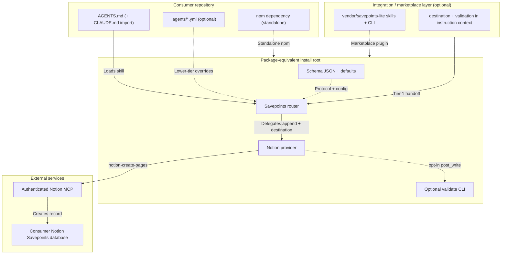

# Savepoints Lite architecture

`@multipliers-dev/savepoints-lite` ships router and provider **skills** (Markdown), default YAML, machine-readable schema/mapping JSON, and an **optional** deterministic post-write validator CLI. Default consumer behaviour remains instruction-only persistence via Notion MCP — no custom MCP server or local spool.

Contrast with [multipliers-dev/savepoints](https://github.com/multipliers-dev/savepoints): full Savepoints optimizes **durable learnings** (five-check rubric, lifecycle hooks, Postgres). Lite optimizes **activity and session narrative** with immediate appends and no lifecycle automation.



**Distribution** (dashed): standalone npm places skills, contracts, and the optional CLI under `node_modules/@multipliers-dev/savepoints-lite/`; Cursor Team Marketplace vendors the same `skills/` tree (including `skills/bin/savepoints-lite-validate.mjs`) under `plugins/team-harness/vendor/savepoints-lite/`. Install alone does not activate Savepoints.

**Execution** (solid): agents load the router from the package-equivalent install root; the router decides when to create Savepoints and assembles provider-neutral records; the configured provider persists through the consumer’s existing Notion MCP when a valid destination is resolved. Opt-in validation (dotted) runs only when resolved `validation.post_write` is true and a compatible Node runtime can execute the CLI.

## Layer model

| Layer | Responsibility |
| --- | --- |
| **Consumer activation** | Root `AGENTS.md` session-log section; Claude Code via `CLAUDE.md` (`@AGENTS.md`). [`docs/adopt.md`](./adopt.md). |
| **Integration (optional)** | Tier-1 `destination` and optional `validation.post_write` in instruction/delegation context — marketplace wrappers, CI agents, etc. Wrapper may read host User Rules; **canonical skills do not**. |
| **Router** [`skills/savepoints/SKILL.md`](../skills/savepoints/SKILL.md) | Event detection, Savepoint assembly, `storage.provider` / `validation.post_write`, carry tier-1 `destination` unchanged, load provider skill, handle outcomes. **No** Notion MCP or validator CLI. |
| **Provider** [`skills/savepoints-notion/SKILL.md`](../skills/savepoints-notion/SKILL.md) | Resolve destination (3 tiers), map Savepoint → Notion (`mapping.json`), MCP write, bounded confirmation; optional same-append verify/repair when validation is enabled. **Does not** decide when to Savepoint or read User Rules. |
| **Validator (optional)** | Self-contained CLI [`skills/bin/savepoints-lite-validate.mjs`](../skills/bin/savepoints-lite-validate.mjs) (npm bin `savepoints-lite-validate`) — checks persisted Notion properties against [`schema.json`](../skills/savepoints/schema.json) + Notion [`mapping.json`](../skills/savepoints-notion/mapping.json). No Notion credentials or MCP. Discovers install root from its location (npm or vendor). |
| **Distribution** | Published npm package is canonical. Standalone consumers must not hand-vendor skills; marketplace may commit a vendor copy of the published `skills/` tree for plugin install. |
| **Runtime** | Persistence uses the consumer’s **Notion MCP**. Executable validation is **opt-in** (`validation.post_write`); requires Node.js ≥ 22 when enabled; missing runtime → **verification unavailable** (fail-open, confirmed create stays `success`). Default remains instruction-only create/confirm. |

**Design principle:** Router owns **what** and **when**; static config and integration context select **where**; provider skills own **how** to persist; the optional validator owns **deterministic property checks** only.

## Distribution compatibility

Savepoints Lite has **two supported distribution paths**. Architectural changes must preserve both:

| Path | Shape |
| --- | --- |
| **Standalone npm** | Consumers install `@multipliers-dev/savepoints-lite` and load skills from that package install |
| **Vendored plugin** | An integration (e.g. Cursor Team Marketplace) distributes a package-equivalent copy of the published skill tree for hosts that do not install the package into consumer `node_modules` |

**Invariants** (constraints, not marketplace implementation details):

1. **Canonical ownership** — Router, provider, schema, mapping, defaults, and validation behaviour live in Savepoints Lite. Wrappers may supply integration configuration and resolve install paths; they must not fork or reimplement that behaviour.
2. **Self-contained package tree** — Features that ship for agents must work from a vendored package-equivalent tree without requiring consumer `npm install`, consumer `node_modules`, or runtime package installation in the host repository.
3. **Installation-relative resolution** — Skills, contracts, and optional executables resolve relative to the package-equivalent install root (the directory that contains the shipped `skills/` tree), not relative to an arbitrary consumer repository layout.
4. **Optional execution / fail open** — Runtime-dependent features (e.g. Node-based validation) stay opt-in and degrade gracefully when the host lacks the runtime or executable: preserve confirmed persistence outcomes; report unavailability; do not install runtimes or block primary work.
5. **No host-specific branching in the package** — Canonical skills and tooling stay host-agnostic. Do not embed marketplace-only paths, User Rules readers, or Cursor-specific control flow in the published package; integrations pass labelled context (destination, validation preference) through the existing handoff.

Downstream vendor scripts and wrapper skills may change without updating this contract, as long as they keep distributing a package-equivalent tree and continue to own host-specific path/config mapping outside Savepoints Lite.

### Why the optional validator is bundled (not a separate package)

Both Savepoints Lite and `@multipliers-dev/plan-validator` (Cursor Team Marketplace) **separate agent orchestration from deterministic checks**. They differ in **who else executes the check**:

| | `@multipliers-dev/plan-validator` | Savepoints Lite post-write validator |
| --- | --- | --- |
| **Independent consumers?** | Yes — e.g. GitHub Actions installs a pinned package and runs it without Cursor or an agent | No — today the check runs only inside the agent-orchestrated Notion persistence path |
| **Distribution** | Standalone npm package so CI (and other hosts) can enforce without the agent | Bundled with the distributed skill tree so vendored/plugin installs get the same optional CLI without a second package |
| **Invocation** | CI/scripts call it directly | Agent may call it when `validation.post_write` is enabled; bundling does **not** guarantee invocation |
| **Enforcement boundary** | Independent CI gate | No separate CI consumer for Savepoint property checks today |

**Principle:** distribute validators as independent packages when they have independent execution consumers; otherwise prefer bundling them with the workflow that invokes them. Bundling here stays compatible with fail-open when Node or the CLI is unavailable — confirmed persistence is not flipped to failure solely because validation could not run.

## Savepoint protocol

Canonical field contract: machine-readable [`skills/savepoints/schema.json`](../skills/savepoints/schema.json); semantics in [`skills/savepoints/schema.md`](../skills/savepoints/schema.md).

Each meaningful work trigger produces **one new record** — no cross-event updates, dedupe, or batching. When `validation.post_write` is enabled, the Notion provider may read back, run the validator CLI, and at most once repair **that** record in the same append; it must not edit earlier rows.

## Configuration precedence

Static resolution only — no environment variables in v2.

**Router** — `storage.provider`:

| Precedence | Location | Overrides |
| --- | --- | --- |
| 1 (highest) | Consumer `.agents/savepoints-lite.yml` (optional) | `storage.provider` |
| 2 (default) | Package [`skills/savepoints/defaults.yml`](../skills/savepoints/defaults.yml) | `notion` |

**Router** — `validation.post_write`:

| Tier | Location | When |
| --- | --- | --- |
| 1 (highest) | Integration **instruction/delegation context** (`validation.post_write`) | Supplied for this delegation |
| 2 | Consumer `.agents/savepoints-lite.yml` (optional) | Tier 1 absent |
| 3 (default) | Package [`skills/savepoints/defaults.yml`](../skills/savepoints/defaults.yml) | `false` |

**Notion provider** — `destination.data_source_id`:

| Tier | Location | When |
| --- | --- | --- |
| 1 | Integration **instruction/delegation context** (`destination` YAML block) | Supplied for this delegation |
| 2 | Consumer `.agents/savepoints-notion.yml` (optional) | Tier 1 absent |
| 3 | Package [`skills/savepoints-notion/defaults.yml`](../skills/savepoints-notion/defaults.yml) | No id in `@2.0.0` |

**Fail open:** no valid id after applicable tiers → no MCP write. **Tier 1 invalid:** fail open without tier 2/3 fallback.

Unsupported or missing `storage.provider` after router resolution → report misconfiguration; do not guess.

Auth stays with each provider’s MCP (Notion MCP for v1).

## Append contract (behavioral)

```text
append(savepoint) → success | failure | unconfirmed
```

- **Same turn:** triggers require a Savepoint in the **same agent turn** as the work event.
- **Per event:** one trigger → one Savepoint → one delegation. **No retry queue.**

### Notion persistence (v1)

Authoritative behavior: [`skills/savepoints-notion/SKILL.md`](../skills/savepoints-notion/SKILL.md).

- **Synchronous-first:** `allow_async: false` when supported.
- **Bounded async:** at most **two** poll follow-ups, then `unconfirmed`.
- **Three outcomes:** `success`, `failure`, `unconfirmed` — do not claim persistence on `unconfirmed`.
- **Same-append verify/repair (opt-in):** when resolved `validation.post_write` is true, after confirmed create: read-back → `skills/bin/savepoints-lite-validate.mjs` → at most one repair from the Savepoint already assembled for that append. Report missing persisted property, contract mismatch, verification unavailable (including missing Node/CLI), or repair confirmation unknown without flipping `success` to `failure`. Default off.

### Failure handling and anti-loop

On `failure` or `unconfirmed`: one-sentence report, resume primary work. A **failed append** is **not** a new work event.

## Privacy and reliability

- **Privacy:** Append-only rows in the consumer’s Notion data source (metadata + narrative sections). No credentials or maintainer destination ids in the package.
- **Reliability:** Best-effort; fail open; no background workers or local spool. Default path is instruction-only; optional deterministic validation does not call Notion.

## Maintenance

Public npm + GitHub; no implied SLA. Maintainer verification history: [adoption verification record on GitHub](https://github.com/multipliers-dev/savepoints-lite/blob/main/docs/adoption-verification-record.md) (repository only, not in tarball).

## v1 / v2 exclusions

Out of scope:

- General read/recovery flows, queues, background reconciliation, `emit-learning`, custom MCP server, local spool (opt-in same-append validate/repair is in scope)
- `savepoints-postgres` provider (future)
- Host User Rules as configuration source

Manual checklist: [`skills/savepoints/verification.md`](../skills/savepoints/verification.md).

## Skill index

[`skills/README.md`](../skills/README.md).
