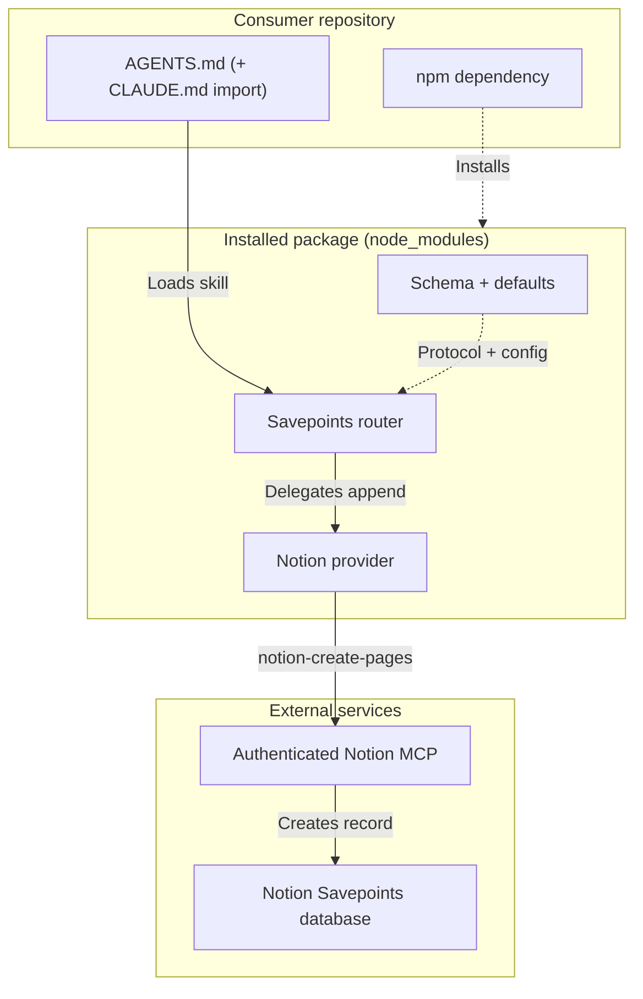

# Savepoints Lite architecture

`@multipliers-dev/savepoints-lite` is an **instruction-only** npm package: router and provider **skills** (Markdown) plus default YAML. There is no executable persistence runtime, custom MCP server, or local spool.

Contrast with [multipliers-dev/savepoints](https://github.com/multipliers-dev/savepoints): full Savepoints optimizes **durable learnings** (five-check rubric, lifecycle hooks, Postgres). Lite optimizes **activity and session narrative** with immediate appends and no lifecycle automation.



**Distribution** (dashed): one install step places the packaged skills and defaults under `node_modules` — install alone does not activate Savepoints.

**Execution** (solid): consumer-owned agent instructions load the installed router; the router decides when to create Savepoints and assembles provider-neutral records; the configured provider persists through the consumer’s existing Notion MCP. There is no custom runtime, MCP server, or local persistence queue.

## Layer model

| Layer | Responsibility |
| --- | --- |
| **Consumer activation** | Root `AGENTS.md` session-log section (shared contract); Claude Code loads it via `CLAUDE.md` (`@AGENTS.md`). Tells agents **when** to read the installed router skill and **where** it lives under `node_modules`. [`docs/adopt.md`](./adopt.md) documents install and merge steps; canonical snippet in `templates/consumer/`. |
| **Router** [`skills/savepoints/SKILL.md`](../skills/savepoints/SKILL.md) | Event detection, Savepoint assembly, read `storage.provider`, load matching provider skill from the **same** npm install, handle `success` / `failure` / `unconfirmed`. **No** Notion properties, SQL, or MCP calls. |
| **Provider** [`skills/savepoints-notion/SKILL.md`](../skills/savepoints-notion/SKILL.md) (v1) | Map Savepoint → Notion, Notion MCP write, bounded async confirmation, return outcome. **Does not** decide when to Savepoint. |
| **Distribution** | npm package only — consumers must not vendor or copy skills. |
| **Runtime** | None — agents follow instructions; persistence uses the consumer’s existing **Notion MCP**. |

**Design principle:** Router owns **what** and **when**; static config selects **where**; provider skills own **how** to persist.

## Installed paths

After `npm install` or `npm ci`:

```text
node_modules/@multipliers-dev/savepoints-lite/skills/savepoints/SKILL.md
node_modules/@multipliers-dev/savepoints-lite/skills/savepoints-notion/SKILL.md
```

`node_modules` must exist in the agent execution environment. npm does **not** register skills with Cursor or Claude native discovery — activation is consumer-owned.

### Consumer activation (runtime contract)

| Piece | Role |
| --- | --- |
| **Root `AGENTS.md`** | Sole runtime logging contract — when to record, parent-agent delegation, installed router path, fail-open behavior ([`templates/consumer/AGENTS.md.snippet`](../templates/consumer/AGENTS.md.snippet) on GitHub until templates ship in npm) |
| **`CLAUDE.md`** | Claude Code only — import hook (`@AGENTS.md`); does not duplicate Savepoints prose |
| **Cursor** | Same committed `AGENTS.md` section; no separate Savepoints Cursor rule in the adoption path |

Install steps and host-specific wiring: [`docs/adopt.md`](./adopt.md).

**Next npm release (after `1.0.0`):** consumer templates under `templates/consumer/` in the tarball (`AGENTS.md.snippet`, `CLAUDE.md.snippet` only). Registry `@1.0.0` has **no** templates — use GitHub or upgrade.

## Savepoint protocol

Canonical field contract: [`skills/savepoints/schema.md`](../skills/savepoints/schema.md).

Provider-neutral shape (summary):

```yaml
title: string
repository: string
agent: string
session_id: optional string  # omit when unknown

content:
  what_was_done: optional string
  decisions_made: optional string
  open_threads: optional string
  errors: optional string
```

Each meaningful work trigger produces **one new record** — no updates, dedupe, or batching across events.

## Configuration precedence

Static resolution only — no dynamic provider discovery.

**Router** — `storage.provider`:

| Precedence | Location | Overrides |
| --- | --- | --- |
| 1 (highest) | Consumer `.agents/savepoints-lite.yml` (optional) | `storage.provider` only |
| 2 (default) | Package [`skills/savepoints/defaults.yml`](../skills/savepoints/defaults.yml) | `notion` in v1 |

**Notion provider** — `destination.data_source_id`:

| Precedence | Location | Overrides |
| --- | --- | --- |
| 1 (highest) | Consumer `.agents/savepoints-notion.yml` (optional) | `destination.data_source_id` only |
| 2 (default) | Package [`skills/savepoints-notion/defaults.yml`](../skills/savepoints-notion/defaults.yml) | Shared Savepoints data source |

Unsupported or missing `storage.provider` after resolution → report misconfiguration; do not guess or fall back.

No v1 environment variables. Auth stays with each provider’s MCP (Notion MCP for v1).

## Append contract (behavioral)

After the router assembles a Savepoint, it **delegates** to the resolved provider skill:

```text
append(savepoint) → success | failure | unconfirmed
```

- **Same turn:** triggers in the router skill require a Savepoint in the **same agent turn** as the work event — not session-end batching.
- **Per event:** one trigger → one Savepoint → one delegation. No session-wide latch after failure. **No retry queue.**

### Notion persistence (v1)

Authoritative behavior: [`skills/savepoints-notion/SKILL.md`](../skills/savepoints-notion/SKILL.md).

- **Synchronous-first:** `allow_async: false` on `notion-create-pages` when supported.
- **Bounded async:** if async is required, poll at most **two** follow-ups, then return `unconfirmed` if still unresolved.
- **Three outcomes:** `success` (confirmed row), `failure` (terminal error), `unconfirmed` (queued or indeterminate — do not claim persistence).

### Failure handling and anti-loop

On `failure` or `unconfirmed`: one-sentence user-visible report, resume primary work, **no retry queue**.

A **failed append** is **not** a new work event — do not chain “write failed → Savepoint about the failure → write failed again.” Only a **later, independent** work trigger may attempt another append.

Failed writes do **not** disable subsequent Savepoint attempts in the same session.

## v1 exclusions

Out of scope for this package version:

- Read/recovery flows, queues, Savepoints capture hooks (`emit-learning`), custom MCP server, local spool, summarization, metrics
- `savepoints-postgres` provider (future: new skill + defaults only)
- Cursor marketplace packaging
- Multi-provider writes or dynamic provider discovery

Manual behavioral checklist for agents: [`skills/savepoints/verification.md`](../skills/savepoints/verification.md) (repository today; next npm release after `1.0.0`). Maintainer verification history: [adoption verification record on GitHub](https://github.com/multipliers-dev/savepoints-lite/blob/main/docs/adoption-verification-record.md) (not in the npm tarball). Hub self-adoption and recorded manual verification are required before claiming adopt-and-verify complete.

## Skill index

See [`skills/README.md`](../skills/README.md) for paths and roles.
